# Computer Vision Mock Exam - 2BI

## Lecture 06 (CNN) to Lecture 08 - Detection and Segmentation

This mock exam is intended to **guide your studies on the topics that may be covered in the exam**. Questions may be presented in different formats, including **open-ended questions, multiple-choice questions, true/false statements, algorithm analysis and validation, and code interpretation**, among others.

**This mock exam should not be used as your only study resource.** Its primary purpose is to familiarize you with the **question formats and expected level of reasoning**, rather than to cover all topics and content that may be assessed in the exam.

### Question 01 – Deep Learning and Convolutional Neural Networks (CNNs)

Traditional Machine Learning and Deep Learning approaches differ in how they extract and represent information from images. Convolutional Neural Networks (CNNs) are widely used in Computer Vision because of their ability to learn hierarchical representations directly from image data.

**Considering the fundamental concepts of Deep Learning and CNNs, which of the following statements is CORRECT?**

A) Deep Learning eliminates the need for training data because neural networks can automatically extract discriminative features without supervision or optimization.

B) Unlike traditional approaches that often rely on handcrafted features, CNNs learn convolutional filters during training, enabling the extraction of increasingly complex visual representations.

C) CNNs use convolutional layers primarily for classification, while fully connected layers are responsible for extracting spatial features directly from the original image.

D) Increasing the number of layers in a CNN always improves generalization, since deeper architectures automatically prevent overfitting.

E) Convolutional filters in CNNs are predefined using traditional image processing operators, such as Sobel and Gaussian filters, and remain fixed throughout training.

<details>
<summary><strong>▶ Show answer</strong></summary>
<div>

<p><strong>Correct answer: B</strong></p>

<p><strong>Explanation:</strong></p>

<ul>
<li><strong>A — Incorrect:</strong> Deep Learning requires training data and optimization.</li>
<li><strong>B — Correct:</strong> CNNs learn convolutional kernels during training.</li>
<li><strong>C — Incorrect:</strong> Convolutional layers primarily extract spatial features.</li>
<li><strong>D — Incorrect:</strong> Increasing network depth does not guarantee better generalization.</li>
<li><strong>E — Incorrect:</strong> CNN filters are generally learned rather than predefined.</li>
</ul>

</div>
</details>

### Question 02 – Weight Optimization and Backpropagation

In Deep Learning, neural networks learn by iteratively adjusting their parameters to minimize a loss function. In Convolutional Neural Networks (CNNs), this optimization process extends beyond the weights of fully connected layers to include the convolutional kernels responsible for feature extraction.

**Considering the training and optimization processes of neural networks, which of the following statements is CORRECT?**

A) During feedforward propagation, the network updates its weights based on the prediction error, while backpropagation is responsible for generating the final predictions.

B) Backpropagation directly minimizes the loss function by replacing incorrect predictions with their corresponding ground-truth labels, without modifying the network parameters.

C) Gradient descent updates the network weights in the direction of the gradient of the loss function, increasing the error temporarily to improve generalization.

D) Backpropagation computes gradients of the loss function with respect to trainable parameters, allowing an optimization algorithm to update both fully connected weights and convolutional kernels.

E) In CNNs, only the fully connected layers are optimized during training, since convolutional kernels are fixed feature extractors.

<details>
<summary><strong>▶ Show answer</strong></summary>
<div>

<p><strong>Correct Answer: D</strong></p>

<p><strong>Explanation:</strong></p>

<ul>
<li><strong>A — Incorrect:</strong> Feedforward propagation computes the network predictions using the current parameters. Backpropagation computes the gradients required for parameter optimization.</li>

<li><strong>B — Incorrect:</strong> Backpropagation applies the chain rule to compute gradients of the loss function with respect to trainable parameters. It does not replace predictions with ground-truth labels.</li>

<li><strong>C — Incorrect:</strong> Gradient descent updates parameters in the opposite direction of the gradient to reduce the loss function locally. Although individual optimization steps do not guarantee a decrease in loss, increasing the error is not its objective.</li>

<li><strong>D — Correct:</strong> Backpropagation computes the gradients of the loss function with respect to trainable parameters. Optimization algorithms, such as SGD and Adam, use these gradients to update the weights. In CNNs, this includes both fully connected weights and convolutional kernels, allowing the network to learn feature extraction and classification jointly.</li>

<li><strong>E — Incorrect:</strong> Convolutional kernels are generally trainable parameters. Unlike handcrafted image descriptors, CNN filters can be optimized through backpropagation to learn representations relevant to the target task.</li>
</ul>

<p><strong>Key Concept:</strong> Feedforward propagation computes predictions, the loss function measures prediction errors, backpropagation computes gradients, and the optimizer updates the trainable parameters.</p>

</div>
</details>

</div>
</details>

### Question 03 – Convolutional Filters and Feature Extraction

Convolutional filters (kernels) are fundamental components of Convolutional Neural Networks (CNNs). They operate on local regions of an input image or feature map, producing new representations that can be progressively refined across multiple convolutional layers.

**Regarding convolutional filters and their role in CNNs, analyze the following statements:**

**01.** Convolutional filters operate on local receptive fields, applying the same set of weights across different spatial positions of the input.

**02.** Each convolutional filter is responsible for extracting exactly one predefined visual pattern, such as a vertical edge, and its weights remain unchanged during training.

**04.** A convolutional layer can learn multiple filters, each producing a corresponding feature map that responds to different patterns in the input.

**08.** Increasing the number of convolutional filters necessarily increases the spatial resolution (height and width) of the output feature maps.

**16.** In a standard convolutional layer, each filter spans all input channels, and its weights are optimized through backpropagation.

**The sum of the CORRECT statements is:**

- a) 05
- b) 13
- c) 17
- d) 21
- e) 29

<details>
<summary><strong>▶ Show answer</strong></summary>
<div>
<p><strong>Correct Answer: D (21 = 01 + 04 + 16)</strong></p>
<p><strong>Explanation:</strong></p>
<ul>
<li><strong>01 — Correct:</strong> Convolutional filters use local receptive fields and weight sharing. The same kernel weights are applied across different spatial positions, enabling the detection of similar patterns throughout the input.</li>
<li><strong>02 — Incorrect:</strong> Convolutional filters are generally learned during training rather than predefined. Their weights are updated through optimization, allowing them to discover task-relevant visual patterns.</li>
<li><strong>04 — Correct:</strong> A convolutional layer can contain multiple learnable filters. Each filter produces an output feature map, potentially capturing different characteristics such as edges, textures, or more complex patterns.</li>
<li><strong>08 — Incorrect:</strong> The number of filters determines the number of output channels, not the spatial resolution. Output height and width depend on kernel size, stride, padding, and dilation.</li>
<li><strong>16 — Correct:</strong> In standard convolution, each filter spans the full depth of the input tensor. Its trainable weights are updated using gradients computed through backpropagation.</li>
</ul>
<p><strong>Key Concept:</strong> Convolutional filters combine local connectivity, weight sharing, and learnable parameters. Multiple filters allow CNNs to construct increasingly rich feature representations.</p>
</div>
</details>

### Question 04 – The Curse of Dimensionality

In Machine Learning and Computer Vision, increasing the number of features may provide additional information about the input data. However, high-dimensional feature spaces introduce challenges that can negatively affect model training, computational efficiency, and generalization.

**Regarding the Curse of Dimensionality, which of the following statements is CORRECT?**

A) Increasing the number of features consistently improves classification performance because additional dimensions provide more information, regardless of dataset size.

B) As dimensionality increases, the feature space grows exponentially, potentially making data increasingly sparse and requiring more training samples to achieve reliable generalization.

C) Distance-based algorithms become more reliable in high-dimensional spaces because Euclidean distances naturally distinguish similar and dissimilar samples more effectively.

D) The Curse of Dimensionality primarily affects Deep Learning models, since traditional Machine Learning algorithms operate independently of the number of input features.

E) Principal Component Analysis (PCA), feature selection, and autoencoders eliminate the Curse of Dimensionality by guaranteeing that all relevant information is preserved during dimensionality reduction.

<details>
<summary><strong>▶ Show answer</strong></summary>
<div>
<p><strong>Correct Answer: B</strong></p>
<p><strong>Explanation:</strong></p>
<ul>
<li><strong>A — Incorrect:</strong> More features do not necessarily improve classification performance. Irrelevant or redundant features can increase model complexity, introduce noise, and increase the risk of overfitting.</li>
<li><strong>B — Correct:</strong> As the number of dimensions increases, the volume of the feature space grows exponentially when the range of each dimension is fixed. Consequently, data becomes increasingly sparse, and substantially more training samples may be required to adequately represent the feature space and achieve reliable generalization.</li>
<li><strong>C — Incorrect:</strong> In high-dimensional spaces, distances between samples may become less discriminative, making similarity measurements less reliable for algorithms that depend on distance metrics.</li>
<li><strong>D — Incorrect:</strong> The Curse of Dimensionality affects several Machine Learning approaches, particularly those relying on distance metrics, density estimation, or high-dimensional feature representations. It is not exclusive to Deep Learning.</li>
<li><strong>E — Incorrect:</strong> Feature selection, PCA, and autoencoders are techniques used to mitigate dimensionality-related problems. However, dimensionality reduction may discard useful information and does not guarantee improved performance or complete elimination of these challenges.</li>
</ul>
<p><strong>Key Concept:</strong> More features do not always mean better learning. Increasing dimensionality can lead to data sparsity, unreliable distance measurements, higher sample requirements, and overfitting. Dimensionality reduction techniques can mitigate these effects by producing more compact feature representations.</p>
</div>
</details>

### Question 05 – Learning Convolutional Kernels Through Optimization

Traditional Computer Vision approaches frequently rely on handcrafted feature extractors, such as predefined convolutional kernels for edge detection. In contrast, Deep Learning extends the concept of weight optimization to the feature extraction process itself.

**Considering the transition from handcrafted features to learnable convolutional kernels in CNNs, which of the following statements is CORRECT?**

A) In traditional image processing, convolutional kernels are optimized through backpropagation, whereas CNNs use fixed filters to ensure consistent feature extraction.

B) Learning convolutional kernels eliminates the need for classification layers, since each filter directly produces the final class prediction.

C) CNNs extend weight optimization to convolutional kernels, allowing the network to automatically learn feature extractors that minimize a task-specific loss function.

D) Convolutional kernels can only be optimized after all fully connected layers have completed their training, since feature extraction and classification must be learned independently.

E) The optimization of convolutional kernels guarantees that the learned features will generalize to any image dataset, regardless of differences in visual characteristics.

<details>
<summary><strong>▶ Show answer</strong></summary>
<div>
<p><strong>Correct Answer: C</strong></p>
<p><strong>Explanation:</strong></p>
<ul>
<li><strong>A — Incorrect:</strong> Traditional image processing commonly uses predefined filters, such as Sobel or Gaussian kernels. In CNNs, convolutional kernels are generally trainable and optimized through backpropagation.</li>
<li><strong>B — Incorrect:</strong> Convolutional kernels extract feature representations. Classification is typically performed by subsequent layers or a classification head that processes these representations.</li>
<li><strong>C — Correct:</strong> CNNs extend the optimization of neural network weights to convolutional kernels. Through backpropagation and gradient-based optimization, the network learns filters that extract features useful for minimizing the task-specific loss function. This enables feature extraction and classification to be optimized jointly.</li>
<li><strong>D — Incorrect:</strong> Convolutional kernels and fully connected weights can be optimized simultaneously through end-to-end training. Gradients propagate backward through the network, allowing both feature extraction and classification components to learn together.</li>
<li><strong>E — Incorrect:</strong> Learned convolutional features are influenced by the training data and optimization objective. They do not guarantee generalization to different datasets or domains, particularly when significant distribution shifts occur.</li>
</ul>
<p><strong>Key Concept:</strong> The fundamental transition from traditional feature engineering to CNNs is the ability to learn feature extractors directly from data. Instead of manually defining which visual patterns should be detected, CNNs optimize convolutional kernels jointly with the remaining network parameters.</p>
</div>
</details>

### Question 06 – CNN Architecture: Feature Extraction and Classification

Convolutional Neural Networks (CNNs) typically consist of two main stages: **feature extraction** and **classification**. These stages combine different operations to progressively transform raw image data into discriminative representations suitable for prediction.

**Regarding the components and their roles in a CNN architecture, analyze the following statements:**

**01.** Convolutional layers apply learnable kernels to extract spatial features, and stacking multiple convolutional layers enables the network to learn increasingly complex representations.

**02.** Activation functions, such as ReLU, introduce nonlinearity into the network, allowing it to learn more complex mappings than a sequence of linear transformations.

**04.** Pooling layers are primarily responsible for optimizing convolutional kernel weights through backpropagation, rather than modifying the spatial dimensions of feature maps.

**08.** Fully connected layers can use features extracted by convolutional layers to perform classification. Alternatively, these features may be provided to other classifiers, such as Support Vector Machines (SVMs).

**16.** Feature extraction and classification must always be performed by separate models, since convolutional and fully connected layers cannot be trained jointly.

**The sum of the CORRECT statements is:**

- a) 07
- b) 11
- c) 13
- d) 19
- e) 27

<details>
<summary><strong>▶ Show answer</strong></summary>
<div>
<p><strong>Correct Answer: B (11 = 01 + 02 + 08)</strong></p>
<p><strong>Explanation:</strong></p>
<ul>
<li><strong>01 — Correct:</strong> Convolutional layers use learnable kernels to extract spatial patterns from input data. By stacking multiple convolutional layers, CNNs can progressively learn representations ranging from low-level features, such as edges and textures, to more complex visual structures.</li>
<li><strong>02 — Correct:</strong> ReLU introduces nonlinearity by applying the function f(x) = max(0, x). Without nonlinear activation functions, a sequence of linear layers would be equivalent to a single linear transformation, limiting the network's representational capacity.</li>
<li><strong>04 — Incorrect:</strong> Pooling layers typically aggregate information from local regions, often reducing the spatial dimensions of feature maps. They are not responsible for optimizing convolutional kernel weights, although gradients can propagate through pooling operations during backpropagation.</li>
<li><strong>08 — Correct:</strong> Fully connected layers can transform learned feature representations into class predictions. Alternatively, features extracted by CNNs can be used as input to traditional classifiers, such as SVMs, demonstrating that feature extraction and classification can be implemented using different approaches.</li>
<li><strong>16 — Incorrect:</strong> CNNs commonly support end-to-end training, in which convolutional and fully connected layers are jointly optimized through backpropagation. Separate training is possible but not mandatory.</li>
</ul>
<p><strong>Key Concept:</strong> A typical CNN architecture combines sequential convolutional layers, learnable kernels, nonlinear activation functions, and pooling operations for feature extraction, followed by a classification stage that may use fully connected layers or alternative classifiers such as SVMs.</p>
</div>
</details>

# CNN Applications, Architectures, and Training Strategies (Lecture 07)

This section explores the **architecture, training, and practical applications of Convolutional Neural Networks (CNNs)**. The questions assess your understanding of **convolutional layers, kernel size, stride, padding, pooling operations, activation functions, and classification layers**, including how these components influence feature extraction and network behavior.

The section also covers **training strategies and generalization challenges**, including overfitting, dropout, data augmentation, transfer learning, early stopping, and model checkpoints.

Additionally, questions may address **the evolution of CNN architectures**, including LeNet-5, AlexNet, VGG, ResNet, DenseNet, MobileNet, and EfficientNet, as well as challenges associated with training deep networks, such as vanishing gradients, and techniques used to mitigate them, including ReLU and Batch Normalization.

Questions may involve **architectural interpretation, hyperparameter analysis, computational reasoning, training strategies, and comparisons between CNN architectures**.

### Question 07 – CNN Feature Extraction and Hierarchical Representations

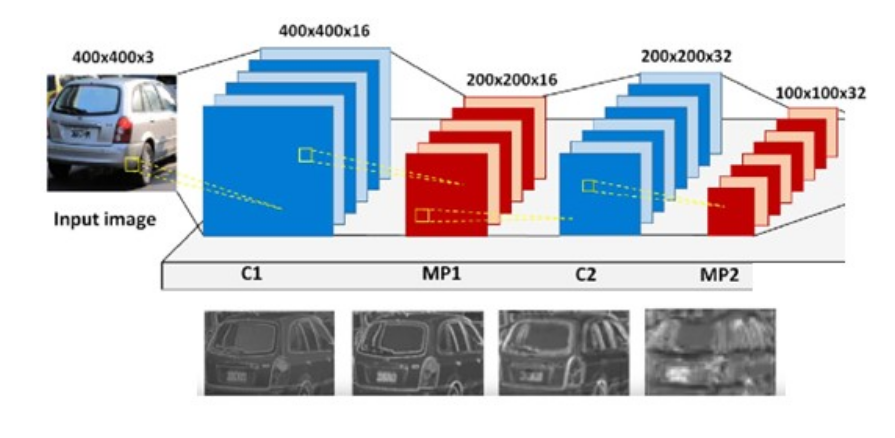

In a Convolutional Neural Network (CNN), feature extraction is performed through successive convolutional layers that transform an input image into increasingly abstract representations. Each layer processes the feature maps produced by previous layers, allowing the network to progressively learn relevant visual patterns.

**Regarding feature extraction in CNNs, which of the following statements is CORRECT?**

A) Each convolutional layer independently processes the original input image, since feature maps generated by previous layers cannot be used as inputs to subsequent layers.

B) Convolutional layers progressively extract hierarchical representations, where early layers typically capture simple patterns, such as edges and textures, while deeper layers can learn more complex visual structures.

C) The feature extraction stage always reduces the number of feature maps after each convolutional layer, since deeper layers must represent images using fewer channels.

D) Convolutional layers require handcrafted descriptors to be computed before training, since their kernels cannot learn visual patterns directly from image data.

E) The main objective of feature extraction is to convert the input image directly into class probabilities, without requiring a classification stage.

<details>
<summary><strong>▶ Show answer</strong></summary>
<div>
<p><strong>Correct Answer: B</strong></p>
<p><strong>Explanation:</strong></p>
<ul>
<li><strong>A — Incorrect:</strong> In a sequential CNN, each convolutional layer typically processes the feature maps generated by the preceding layer, allowing representations to become progressively more complex.</li>
<li><strong>B — Correct:</strong> CNNs learn hierarchical representations. Early convolutional layers typically detect low-level features, such as edges and textures, while deeper layers combine these features into increasingly complex patterns and structures.</li>
<li><strong>C — Incorrect:</strong> The number of feature maps is determined by the number of convolutional filters. Deeper layers may increase, decrease, or maintain the number of channels depending on the architecture.</li>
<li><strong>D — Incorrect:</strong> Convolutional kernels are generally learned automatically during training, reducing the need for manually designed feature descriptors.</li>
<li><strong>E — Incorrect:</strong> Feature extraction produces representations that can subsequently be processed by classification layers. Class probabilities are typically generated by the classification stage, often using Softmax.</li>
</ul>
<p><strong>Key Concept:</strong> CNNs perform hierarchical feature extraction through sequential convolutional layers, transforming raw image information into increasingly abstract and discriminative representations.</p>
</div>
</details>

---

### Question 08 – Convolutional Layers and Hyperparameters

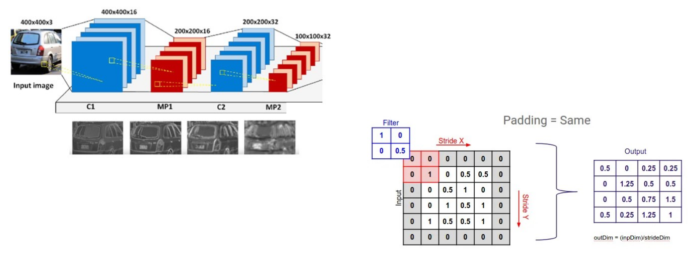

Convolutional layers use learnable filters to extract spatial information from input images or feature maps. Their behavior is controlled by several hyperparameters, including **kernel size, stride, padding, and number of filters**.

**Regarding these hyperparameters, analyze the following statements:**

**01.** Kernel size determines the spatial dimensions of the local region processed by a convolutional filter.

**02.** Increasing the stride generally reduces the spatial dimensions of the output feature maps, assuming the other convolutional parameters remain unchanged.

**04.** Padding can be used to control the spatial dimensions of the output, including preserving the input height and width under appropriate convolutional settings.

**08.** Increasing the number of convolutional filters directly increases the spatial dimensions (height and width) of the output feature maps.

**16.** The number of filters determines the number of output channels produced by a standard convolutional layer.

**The sum of the CORRECT statements is:**

- a) 07
- b) 15
- c) 19
- d) 23
- e) 31

<details>
<summary><strong>▶ Show answer</strong></summary>
<div>
<p><strong>Correct Answer: D (23 = 01 + 02 + 04 + 16)</strong></p>
<p><strong>Explanation:</strong></p>
<ul>
<li><strong>01 — Correct:</strong> Kernel size defines the spatial dimensions of the convolutional filter, such as 3×3 or 5×5, determining the local region examined at each spatial position.</li>
<li><strong>02 — Correct:</strong> Stride controls how far the filter moves between consecutive positions. Increasing stride generally produces smaller output feature maps when the other parameters remain fixed.</li>
<li><strong>04 — Correct:</strong> Padding adds values, commonly zeros, around the input boundaries. Appropriate padding can preserve spatial dimensions, such as using a 3×3 kernel with stride 1 and padding 1.</li>
<li><strong>08 — Incorrect:</strong> The number of filters determines the number of output channels, not their spatial dimensions. Output height and width depend on kernel size, stride, padding, and dilation.</li>
<li><strong>16 — Correct:</strong> Each convolutional filter produces one output channel in a standard convolutional layer. Therefore, a layer with 32 filters produces an output tensor with 32 channels.</li>
</ul>
<p><strong>Key Concept:</strong> Kernel size controls the local receptive field, stride controls the spatial step, padding influences boundary handling and output dimensions, and the number of filters determines the output depth.</p>
</div>
</details>

### Question 09 – Pooling Layers in Convolutional Neural Networks

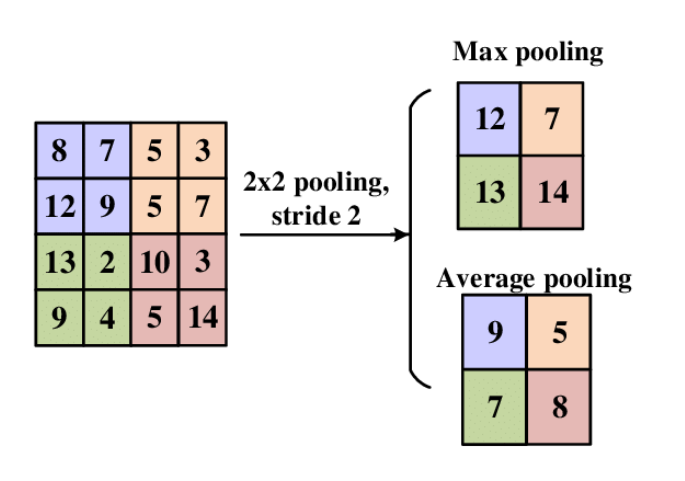

Pooling layers are commonly used in Convolutional Neural Networks (CNNs) to reduce the spatial dimensions of feature maps while retaining relevant information. Two widely used approaches are **Max Pooling** and **Average Pooling**, which aggregate information from local regions using different operations.

**Regarding pooling layers and their role in CNN architectures, which of the following statements is CORRECT?**

A) Max Pooling computes the average activation within each local region, preserving the overall distribution of features, while Average Pooling selects the strongest activation.

B) Pooling layers increase the spatial resolution of feature maps, allowing CNNs to recover fine-grained details lost during convolution.

C) Pooling layers are responsible for learning convolutional filters, since their weights are optimized through backpropagation to identify relevant visual patterns.

D) Max Pooling preserves the strongest activation within each local region, while Average Pooling computes the mean activation. Both operations can reduce spatial dimensions and provide some robustness to small spatial translations.

E) Pooling layers guarantee complete translation invariance, ensuring that the extracted features remain identical regardless of how far an object moves within an image.

<details>
<summary><strong>▶ Show answer</strong></summary>
<div>
<p><strong>Correct Answer: D</strong></p>
<p><strong>Explanation:</strong></p>
<ul>
<li><strong>A — Incorrect:</strong> The operations are reversed. Max Pooling selects the maximum activation within a local region, while Average Pooling computes the arithmetic mean of the activations.</li>
<li><strong>B — Incorrect:</strong> Pooling layers commonly reduce spatial dimensions rather than increase them. This reduction decreases computational requirements in subsequent layers but may discard spatial details.</li>
<li><strong>C — Incorrect:</strong> Standard Max Pooling and Average Pooling do not contain trainable weights. They apply fixed aggregation operations, although gradients can propagate through them during backpropagation.</li>
<li><strong>D — Correct:</strong> Max Pooling retains the strongest activation in each local region, emphasizing prominent features. Average Pooling computes the mean activation, producing a smoother representation. Both can reduce feature map dimensions and provide limited robustness to small spatial translations.</li>
<li><strong>E — Incorrect:</strong> Pooling can provide some local translation invariance, but it does not guarantee complete invariance. Larger translations or changes in feature positions may still affect the resulting feature maps.</li>
</ul>
<p><strong>Key Concept:</strong> Pooling layers aggregate local information, commonly reducing spatial resolution and computational cost. Max Pooling emphasizes strong activations, whereas Average Pooling preserves average responses. Both may improve robustness to small spatial variations, but can also discard useful spatial information.</p>
</div>
</details>

### Question 10 – CNN Architecture and Feature Extraction

Consider a Convolutional Neural Network (CNN) designed for image classification with the following architecture:

Input Image → Conv2D → ReLU → MaxPooling → Conv2D → ReLU → MaxPooling → Flatten → Fully Connected → Softmax

**Regarding the operations performed by this architecture, analyze the following statements:**

**01.** Convolutional layers use learnable kernels to extract spatial features, while ReLU introduces nonlinearity into the network.

**02.** MaxPooling reduces spatial dimensions by selecting the maximum activation within local regions, potentially discarding some spatial information.

**04.** The second convolutional layer processes feature maps generated by previous layers, allowing the network to learn more complex representations.

**08.** The Flatten operation learns additional convolutional filters to convert spatial features into class probabilities.

**16.** The Softmax function transforms classification scores into a probability distribution over the output classes.

**The sum of the CORRECT statements is:**

- a) 07
- b) 15
- c) 19
- d) 23
- e) 31

<details>
<summary><strong>▶ Show answer</strong></summary>
<div>
<p><strong>Correct Answer: D (23 = 01 + 02 + 04 + 16)</strong></p>
<p><strong>Explanation:</strong></p>
<ul>
<li><strong>01 — Correct:</strong> Convolutional layers apply learnable kernels to extract spatial patterns, while ReLU introduces nonlinearity, allowing the network to represent more complex relationships.</li>
<li><strong>02 — Correct:</strong> MaxPooling selects the maximum activation within each pooling window. With appropriate stride and window size, it reduces spatial resolution, potentially discarding detailed positional information.</li>
<li><strong>04 — Correct:</strong> Sequential convolutional layers operate on feature maps produced by preceding layers. This allows CNNs to progressively combine simple patterns into more complex representations.</li>
<li><strong>08 — Incorrect:</strong> Flatten is a parameter-free reshaping operation that converts multidimensional feature maps into a one-dimensional vector. It does not learn convolutional filters or directly generate class probabilities.</li>
<li><strong>16 — Correct:</strong> Softmax converts classification scores (logits) into normalized values between 0 and 1 that sum to 1, producing a probability distribution over the classes.</li>
</ul>
<p><strong>Key Concept:</strong> CNN architectures combine convolutional layers for feature extraction, activation functions for nonlinearity, pooling for spatial aggregation, and classification layers for prediction.</p>
</div>
</details>

---

### Question 11 – Convolutional Layers, Pooling, and Output Dimensions

Consider a CNN that receives an RGB image with dimensions **64 × 64 × 3** and applies the following operations sequentially:

1. **Conv2D:** 16 filters, kernel size 3 × 3, stride 1, padding = "same".
2. **MaxPooling2D:** pool size 2 × 2, stride 2.
3. **Conv2D:** 32 filters, kernel size 3 × 3, stride 1, padding = "same".
4. **MaxPooling2D:** pool size 2 × 2, stride 2.

Assume that all operations use standard convolution and pooling without dilation.

**What are the output dimensions after each operation?**

A) 64 × 64 × 16 → 32 × 32 × 16 → 32 × 32 × 32 → 16 × 16 × 32

B) 62 × 62 × 16 → 31 × 31 × 16 → 29 × 29 × 32 → 14 × 14 × 32

C) 64 × 64 × 3 → 32 × 32 × 3 → 32 × 32 × 16 → 16 × 16 × 16

D) 64 × 64 × 16 → 32 × 32 × 8 → 32 × 32 × 32 → 16 × 16 × 16

E) 64 × 64 × 16 → 32 × 32 × 16 → 16 × 16 × 32 → 8 × 8 × 32

<details>
<summary><strong>▶ Show answer</strong></summary>
<div>
<p><strong>Correct Answer: A</strong></p>
<p><strong>Step-by-Step Explanation:</strong></p>
<ol>
<li><strong>First Conv2D:</strong> The input is 64 × 64 × 3. With kernel size 3 × 3, stride 1, and "same" padding, the spatial dimensions remain unchanged. The 16 filters produce 16 output channels. Output: <strong>64 × 64 × 16</strong>.</li>
<li><strong>First MaxPooling2D:</strong> A 2 × 2 pooling window with stride 2 reduces height and width by a factor of 2, while preserving the number of channels. Output: <strong>32 × 32 × 16</strong>.</li>
<li><strong>Second Conv2D:</strong> The spatial dimensions remain unchanged because of "same" padding and stride 1. The 32 filters produce 32 output channels. Output: <strong>32 × 32 × 32</strong>.</li>
<li><strong>Second MaxPooling2D:</strong> The spatial dimensions are reduced by another factor of 2, while the number of channels remains unchanged. Output: <strong>16 × 16 × 32</strong>.</li>
</ol>
<p><strong>Why the other alternatives are incorrect:</strong></p>
<ul>
<li><strong>B — Incorrect:</strong> The dimensions correspond to convolutions without appropriate padding. The specified "same" padding preserves spatial dimensions for stride 1.</li>
<li><strong>C — Incorrect:</strong> The number of output channels in a standard convolution is determined by the number of filters, not by the original number of input channels.</li>
<li><strong>D — Incorrect:</strong> Standard MaxPooling does not reduce the number of channels. It performs spatial aggregation independently within each channel.</li>
<li><strong>E — Incorrect:</strong> The second convolution has stride 1 and "same" padding, so it does not reduce spatial dimensions from 32 × 32 to 16 × 16.</li>
</ul>
<p><strong>Key Concept:</strong> Convolutional layers control output channels through the number of filters, while kernel size, stride, and padding determine spatial dimensions. Pooling commonly reduces spatial resolution without changing the number of channels.</p>
</div>
</details>

### Question 12 – CNN Architecture Implementation

Consider the Convolutional Neural Network (CNN) architecture illustrated in the figure below.

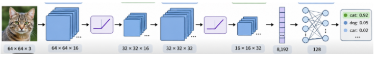The architecture receives an RGB image and applies convolutional layers, ReLU activation functions, MaxPooling operations, and fully connected layers to perform image classification.

In TensorFlow/Keras, the configuration of convolutional layers depends on parameters such as the number of filters, kernel size, stride, padding, and activation function.

**Which of the following TensorFlow/Keras implementations CORRECTLY reproduces the illustrated architecture, including the dimensions of the intermediate feature maps?**

Assume that:

- `tensorflow` has been imported as `tf`.
- `C = 3` represents the number of output classes.
- Convolutional layers use 3 × 3 kernels, stride 1, and padding that preserves spatial dimensions.
- MaxPooling uses 2 × 2 windows with stride 2.
- All unspecified parameters use their TensorFlow/Keras default values.

**A)**

```python
model = tf.keras.Sequential([
    tf.keras.layers.Input(shape=(64, 64, 3)),
    tf.keras.layers.Conv2D(16, (3, 3), activation='relu', padding='same'),
    tf.keras.layers.MaxPooling2D((2, 2)),
    tf.keras.layers.Conv2D(32, (3, 3), activation='relu', padding='same'),
    tf.keras.layers.MaxPooling2D((2, 2)),
    tf.keras.layers.Flatten(),
    tf.keras.layers.Dense(128, activation='relu'),
    tf.keras.layers.Dense(C, activation='softmax')
])
```

**B)**

```python
model = tf.keras.Sequential([
    tf.keras.layers.Input(shape=(64, 64, 3)),
    tf.keras.layers.Conv2D(64, (32, 16), activation='relu', padding='same'),
    tf.keras.layers.MaxPooling2D((2, 2)),
    tf.keras.layers.Conv2D(32, (3, 3), activation='relu', padding='same'),
    tf.keras.layers.MaxPooling2D((2, 2)),
    tf.keras.layers.Flatten(),
    tf.keras.layers.Dense(128, activation='relu'),
    tf.keras.layers.Dense(C, activation='softmax')
])
```

**C)**

```python
model = tf.keras.Sequential([
    tf.keras.layers.Input(shape=(64, 64, 3)),
    tf.keras.layers.Conv2D(16, (3, 3), activation='relu', padding='same'),
    tf.keras.layers.Conv2D(32, (3, 3), activation='relu', padding='same'),
    tf.keras.layers.MaxPooling2D((2, 2)),
    tf.keras.layers.MaxPooling2D((2, 2)),
    tf.keras.layers.Flatten(),
    tf.keras.layers.Dense(128, activation='relu'),
    tf.keras.layers.Dense(C, activation='softmax')
])
```

**D)**

```python
model = tf.keras.Sequential([
    tf.keras.layers.Input(shape=(64, 64, 3)),
    tf.keras.layers.Conv2D(16, (32, 32), activation='relu', padding='same'),
    tf.keras.layers.MaxPooling2D((2, 2)),
    tf.keras.layers.Conv2D(32, (3, 3), activation='relu', padding='same'),
    tf.keras.layers.MaxPooling2D((2, 2)),
    tf.keras.layers.Flatten(),
    tf.keras.layers.Dense(128, activation='relu'),
    tf.keras.layers.Dense(C, activation='softmax')
])
```

**E)**

```python
model = tf.keras.Sequential([
    tf.keras.layers.Input(shape=(64, 64, 3)),
    tf.keras.layers.Conv2D(16, (3, 3), activation='relu', padding='64'),
    tf.keras.layers.MaxPooling2D((2, 2)),
    tf.keras.layers.Conv2D(32, (3, 3), activation='relu', padding='same'),
    tf.keras.layers.MaxPooling2D((2, 2)),
    tf.keras.layers.Flatten(),
    tf.keras.layers.Dense(128, activation='relu'),
    tf.keras.layers.Dense(C, activation='softmax')
])
```

**F)**

```python
model = tf.keras.Sequential([
    tf.keras.layers.Input(shape=(64, 64, 3)),
    tf.keras.layers.Conv2D(16, (3, 3), activation='relu', padding='valid'),
    tf.keras.layers.MaxPooling2D((2, 2)),
    tf.keras.layers.Conv2D(32, (3, 3), activation='relu', padding='same'),
    tf.keras.layers.MaxPooling2D((2, 2)),
    tf.keras.layers.Flatten(),
    tf.keras.layers.Dense(128, activation='relu'),
    tf.keras.layers.Dense(C, activation='softmax')
])
```

<details>
<summary><strong>▶ Show answer</strong></summary>
<div>
<p><strong>Correct Answer: A</strong></p>
<p><strong>Explanation:</strong></p>
<ul>
<li><strong>A — Correct:</strong> The implementation correctly reproduces the illustrated architecture. It receives a 64 × 64 × 3 RGB image, applies a convolution with 16 filters, reduces spatial dimensions through MaxPooling, applies another convolution with 32 filters, performs a second MaxPooling operation, and uses Flatten followed by Dense layers with 128 and 3 neurons.</li>
<li><strong>B — Incorrect:</strong> The first convolution uses 64 filters with a kernel size of 32 × 16. In Conv2D(filters, kernel_size), the first argument specifies the number of output channels, while the second specifies the spatial dimensions of the convolutional kernel. Therefore, the first output would have 64 channels instead of the expected 16.</li>
<li><strong>C — Incorrect:</strong> Both convolutional layers are applied before the pooling operations. Although the final feature map dimensions are 16 × 16 × 32, the intermediate representations do not match the illustrated architecture. The first pooling layer should occur immediately after the convolution with 16 filters.</li>
<li><strong>D — Incorrect:</strong> The first convolution uses a 32 × 32 kernel instead of the specified 3 × 3 kernel. Although same padding preserves the spatial dimensions and the resulting tensor shape matches the figure, the convolutional operation and its number of trainable parameters are different.</li>
<li><strong>E — Incorrect:</strong> The padding argument does not accept '64' as a valid configuration. TensorFlow/Keras Conv2D supports padding values such as 'same' and 'valid'. The value 64 cannot be used to specify the spatial dimensions of the feature maps.</li>
<li><strong>F — Incorrect:</strong> The first convolution uses valid padding, which reduces the spatial dimensions from 64 × 64 to 62 × 62. The subsequent MaxPooling operation produces 31 × 31 × 16 instead of the expected 32 × 32 × 16. Consequently, the remaining feature map dimensions also differ from the illustrated architecture.</li>
</ul>
<p><strong>Expected Output Dimensions:</strong></p>
<ol>
<li>Input: <strong>64 × 64 × 3</strong></li>
<li>Conv2D (16 filters, 3 × 3): <strong>64 × 64 × 16</strong></li>
<li>MaxPooling2D (2 × 2): <strong>32 × 32 × 16</strong></li>
<li>Conv2D (32 filters, 3 × 3): <strong>32 × 32 × 32</strong></li>
<li>MaxPooling2D (2 × 2): <strong>16 × 16 × 32</strong></li>
<li>Flatten: <strong>8,192 features</strong></li>
<li>Dense: <strong>128 neurons</strong></li>
<li>Output: <strong>3 classes (Softmax)</strong></li>
</ol>
<p><strong>Key Concept:</strong> In TensorFlow/Keras, Conv2D(filters, kernel_size) defines the number of output channels and the spatial size of the convolutional kernel, respectively. The spatial dimensions of feature maps depend on kernel size, stride, and padding, while MaxPooling reduces spatial resolution without changing the number of channels. Different layer sequences may produce identical final tensor dimensions without representing the same CNN architecture.</p>
</div>
</details>

### Question 13 – Deep CNN Architecture Implementation

Consider the Convolutional Neural Network (CNN) architecture illustrated in the figure below.

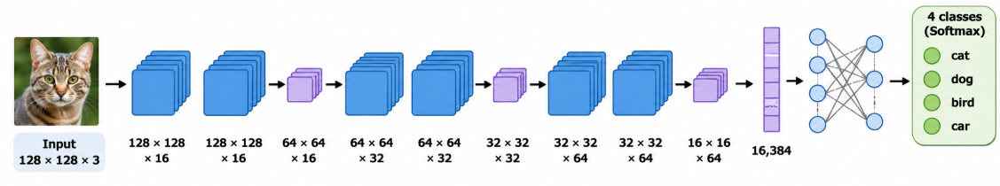

The network receives an RGB image of size **128 × 128 × 3** and performs feature extraction using six convolutional layers organized into three blocks, interleaved with MaxPooling operations. The extracted features are subsequently processed by fully connected layers for classification.

**Which of the following TensorFlow/Keras implementations CORRECTLY reproduces the architecture illustrated in the figure, including the number of filters, layer sequence, spatial dimensions, and classification stage?**

Assume that:

- `tensorflow` has been imported as `tf`.
- `C` represents the number of output classes.
- Convolutional layers use 3 × 3 kernels, stride 1, `padding='same'`, and ReLU activation.
- MaxPooling operations use 2 × 2 windows with stride 2.
- All unspecified parameters use their TensorFlow/Keras default values.

**A)**

```python
model = tf.keras.Sequential([
    tf.keras.layers.Input(shape=(128, 128, 3)),
    tf.keras.layers.Conv2D(16, 3, padding='same', activation='relu'),
    tf.keras.layers.Conv2D(16, 3, padding='same', activation='relu'),
    tf.keras.layers.MaxPooling2D(2),
    tf.keras.layers.Conv2D(32, 3, padding='same', activation='relu'),
    tf.keras.layers.Conv2D(32, 3, padding='same', activation='relu'),
    tf.keras.layers.MaxPooling2D(2),
    tf.keras.layers.Conv2D(64, 3, padding='same', activation='relu'),
    tf.keras.layers.Conv2D(128, 3, padding='same', activation='relu'),
    tf.keras.layers.MaxPooling2D(2),
    tf.keras.layers.Flatten(),
    tf.keras.layers.Dense(32768, activation='relu'),
    tf.keras.layers.Dense(C, activation='sigmoid')
])
```

**B)**

```python
model = tf.keras.Sequential([
    tf.keras.layers.Input(shape=(128, 128, 3)),
    tf.keras.layers.Conv2D(16, 3, padding='same', activation='relu'),
    tf.keras.layers.MaxPooling2D(2),
    tf.keras.layers.Conv2D(16, 3, padding='same', activation='relu'),
    tf.keras.layers.Conv2D(32, 3, padding='same', activation='relu'),
    tf.keras.layers.MaxPooling2D(2),
    tf.keras.layers.Conv2D(32, 3, padding='same', activation='relu'),
    tf.keras.layers.Conv2D(64, 3, padding='same', activation='relu'),
    tf.keras.layers.Conv2D(128, 3, padding='same', activation='relu'),
    tf.keras.layers.MaxPooling2D(2),
    tf.keras.layers.Flatten(),
    tf.keras.layers.Dense(256, activation='relu'),
    tf.keras.layers.Dense(C, activation='softmax')
])
```

**C)**

```python
model = tf.keras.Sequential([
    tf.keras.layers.Input(shape=(128, 128, 3)),
    tf.keras.layers.Conv2D(16, 3, padding='same', activation='relu'),
    tf.keras.layers.Conv2D(16, 3, padding='same', activation='relu'),
    tf.keras.layers.MaxPooling2D(2),
    tf.keras.layers.Conv2D(32, 3, padding='same', activation='relu'),
    tf.keras.layers.Conv2D(32, 3, padding='same', activation='relu'),
    tf.keras.layers.MaxPooling2D(2),
    tf.keras.layers.Conv2D(64, 3, padding='same', activation='relu'),
    tf.keras.layers.Conv2D(128, 3, padding='same', activation='relu'),
    tf.keras.layers.Flatten(),
    tf.keras.layers.MaxPooling2D(2),
    tf.keras.layers.Dense(256, activation='relu'),
    tf.keras.layers.Dense(C, activation='sigmoid')
])
```

**D)**

```python
model = tf.keras.Sequential([
    tf.keras.layers.Input(shape=(128, 128, 3)),
    tf.keras.layers.Conv2D(16, 3, padding='same', activation='relu'),
    tf.keras.layers.Conv2D(16, 3, padding='same', activation='relu'),
    tf.keras.layers.MaxPooling2D(2),
    tf.keras.layers.Conv2D(32, 3, padding='same', activation='relu'),
    tf.keras.layers.Conv2D(32, 3, padding='same', activation='relu'),
    tf.keras.layers.MaxPooling2D(2),
    tf.keras.layers.Conv2D(32, 64, padding='same', activation='relu'),
    tf.keras.layers.Conv2D(32, 128, padding='same', activation='relu'),
    tf.keras.layers.MaxPooling2D(2),
    tf.keras.layers.Flatten(),
    tf.keras.layers.Dense(256, activation='relu'),
    tf.keras.layers.Dense(C, activation='softmax')
])
```

**E)**

```python
model = tf.keras.Sequential([
    tf.keras.layers.Input(shape=(128, 128, 3)),
    tf.keras.layers.Conv2D(16, 3, padding='same', activation='relu'),
    tf.keras.layers.Conv2D(16, 3, padding='same', activation='relu'),
    tf.keras.layers.MaxPooling2D(2),
    tf.keras.layers.Conv2D(32, 3, padding='same', activation='relu'),
    tf.keras.layers.Conv2D(32, 3, padding='same', activation='relu'),
    tf.keras.layers.MaxPooling2D(2),
    tf.keras.layers.Conv2D(64, 3, padding='same', activation='relu'),
    tf.keras.layers.Conv2D(128, 3, padding='same', activation='relu'),
    tf.keras.layers.MaxPooling2D(2),
    tf.keras.layers.Flatten(),
    tf.keras.layers.Dense(256, activation='relu'),
    tf.keras.layers.Dense(C, activation='softmax')
])
```

**F)**

```python
model = tf.keras.Sequential([
    tf.keras.layers.Input(shape=(128, 128, 3)),
    tf.keras.layers.Conv2D(16, 3, padding='same', activation='relu'),
    tf.keras.layers.Conv2D(16, 3, padding='same', activation='relu'),
    tf.keras.layers.MaxPooling2D(2),
    tf.keras.layers.Conv2D(32, 3, padding='same', activation='relu'),
    tf.keras.layers.Conv2D(32, 3, padding='same', activation='relu'),
    tf.keras.layers.MaxPooling2D(2),
    tf.keras.layers.Conv2D(64, 3, padding='same', activation='relu'),
    tf.keras.layers.MaxPooling2D(2),
    tf.keras.layers.Conv2D(128, 3, padding='same', activation='relu'),
    tf.keras.layers.Flatten(),
    tf.keras.layers.Dense(256, activation='relu'),
    tf.keras.layers.Dense(C, activation='softmax')
])
```

<details>
<summary><strong>▶ Show answer</strong></summary>
<div>
<p><strong>Correct Answer: E</strong></p>
<p><strong>Explanation:</strong></p>
<ul>
<li><strong>A — Incorrect:</strong> The fully connected layer contains 32,768 neurons instead of 256. The value 32,768 represents the number of features produced by Flatten, not the number of neurons required in the Dense layer. Additionally, the output layer uses sigmoid instead of Softmax.</li>
<li><strong>B — Incorrect:</strong> The first MaxPooling operation occurs immediately after the first convolutional layer instead of after two consecutive convolutions. This changes the sequence of feature extraction and spatial downsampling.</li>
<li><strong>C — Incorrect:</strong> Flatten is applied before the final MaxPooling operation. Flatten converts the feature maps into a one-dimensional feature vector, making the resulting tensor incompatible with MaxPooling2D. Additionally, the output layer uses sigmoid instead of Softmax.</li>
<li><strong>D — Incorrect:</strong> The final two convolutional layers use Conv2D(32, 64) and Conv2D(32, 128). In TensorFlow/Keras, the first argument specifies the number of filters, while the second specifies the kernel size. These layers produce 32 output channels with large convolutional kernels instead of 64 and 128 output channels with 3 × 3 kernels.</li>
<li><strong>E — Correct:</strong> The implementation contains six convolutional layers organized into three blocks: (16, 16), (32, 32), and (64, 128) filters. Each block is followed by MaxPooling. Flatten produces 32,768 features, followed by Dense(256) and Softmax classification.</li>
<li><strong>F — Incorrect:</strong> The final MaxPooling operation is placed between the fifth and sixth convolutional layers instead of after both convolutions. Although the final tensor dimensions may match, the order of operations differs from the illustrated architecture.</li>
</ul>
<p><strong>Expected Output Dimensions:</strong></p>
<ol>
<li>Input: <strong>128 × 128 × 3</strong></li>
<li>Conv2D (16 filters): <strong>128 × 128 × 16</strong></li>
<li>Conv2D (16 filters): <strong>128 × 128 × 16</strong></li>
<li>MaxPooling2D: <strong>64 × 64 × 16</strong></li>
<li>Conv2D (32 filters): <strong>64 × 64 × 32</strong></li>
<li>Conv2D (32 filters): <strong>64 × 64 × 32</strong></li>
<li>MaxPooling2D: <strong>32 × 32 × 32</strong></li>
<li>Conv2D (64 filters): <strong>32 × 32 × 64</strong></li>
<li>Conv2D (128 filters): <strong>32 × 32 × 128</strong></li>
<li>MaxPooling2D: <strong>16 × 16 × 128</strong></li>
<li>Flatten: <strong>32,768 features</strong></li>
<li>Dense: <strong>256 neurons</strong></li>
<li>Output: <strong>C classes (Softmax)</strong></li>
</ol>
<p><strong>Key Concept:</strong> Correctly interpreting CNN architectures requires distinguishing the number of convolutional filters from kernel dimensions, understanding the order of convolutional and pooling operations, and recognizing that Flatten converts feature maps into a vector without introducing trainable parameters. Different sequences of operations may produce identical final tensor dimensions while implementing different architectures.</p>
</div>
</details>

### Question 14 – Dropout and Regularization

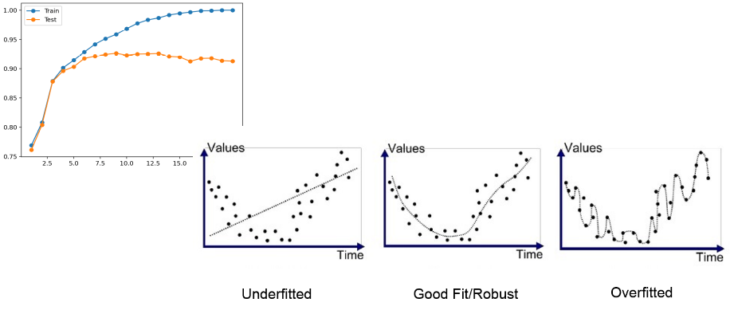

Dropout is a regularization technique frequently employed in deep neural networks to reduce overfitting.

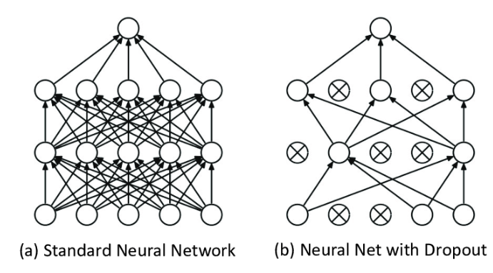

**Which statement BEST describes how Dropout operates and its implications during training and inference?**

**A)** Dropout permanently removes neurons with small weights, reducing the number of trainable parameters and producing a compressed network.

**B)** Dropout randomly deactivates a fraction of neuron outputs during training, discouraging excessive co-adaptation. During inference,  the full network is used without additional activation scaling.

**C)** Dropout randomly removes a fraction of training samples at each epoch, forcing the model to learn from smaller subsets of the dataset.

**D)** Dropout randomly initializes the weights of selected neurons at every iteration, preventing the network from converging to local minima.

**E)** Dropout is applied exclusively during inference to estimate model uncertainty, while all neurons remain active during training.

<details>
<summary><strong>▶ Show answer</strong></summary>
<div>
<p><strong>Correct Answer: B</strong></p>
<p><strong>Explanation:</strong></p>
<ul>
<li><strong>A — Incorrect:</strong> Dropout temporarily masks activations during training; it does not permanently remove neurons or reduce the number of trainable parameters.</li>
<li><strong>B — Correct:</strong> Dropout randomly sets selected activations to zero during training and surviving activations are scaled, so no additional scaling is required during standard inference.</li>
<li><strong>C — Incorrect:</strong> Dropout operates on network activations, not by removing training samples.</li>
<li><strong>D — Incorrect:</strong> Dropout does not reinitialize network weights. The model parameters are still updated through gradient-based optimization.</li>
<li><strong>E — Incorrect:</strong> Standard Dropout is active during training and disabled during inference. Monte Carlo Dropout is a specialized exception in which stochastic inference is deliberately enabled.</li>
</ul>
<p><strong>Key Concept:</strong> Dropout is a stochastic regularization mechanism that reduces dependence on specific activation patterns without changing the underlying architecture or parameter count.</p>
</div>
</details>

---

### Question 15 – Data Augmentation and Generalization

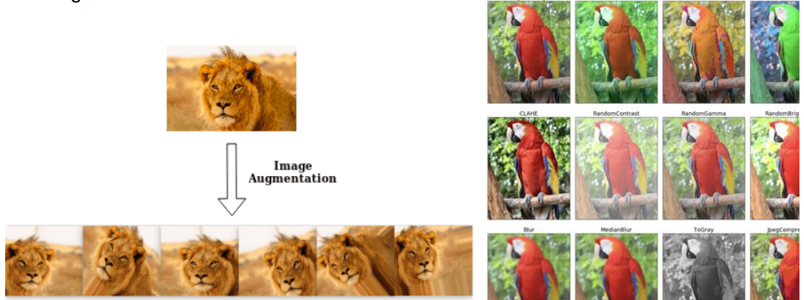

A CNN is trained to classify objects in a relatively small image dataset. The model achieves high training accuracy but performs poorly on previously unseen images.

The researcher decides to introduce data augmentation during training.

**Which statement CORRECTLY describes the purpose and appropriate application of data augmentation?**

**A)** Data augmentation increases the effective diversity of training samples through transformations that preserve the relevant labels, helping the model become less sensitive to nuisance variations.

**B)** Data augmentation guarantees that a sufficiently deep CNN will not overfit, independently of the original dataset size or the transformations employed.

**C)** Data augmentation should be applied to the training and test sets using the same random transformations to ensure that both datasets contain equivalent variations.

**D)** Data augmentation improves generalization primarily by increasing the number of trainable parameters, allowing the model to represent more complex decision boundaries.

**E)** All geometric transformations preserve class labels, regardless of the classification task. Consequently, rotations and flips can always be applied without restrictions.

<details>
<summary><strong>▶ Show answer</strong></summary>
<div>
<p><strong>Correct Answer: A</strong></p>
<p><strong>Explanation:</strong></p>
<ul>
<li><strong>A — Correct:</strong> Appropriate transformations introduce plausible variability into the training distribution, encouraging invariance to nuisance factors such as moderate changes in orientation, position, or illumination.</li>
<li><strong>B — Incorrect:</strong> Data augmentation can reduce overfitting but does not guarantee generalization. Its effectiveness depends on dataset properties, model capacity, and transformation validity.</li>
<li><strong>C — Incorrect:</strong> Stochastic training augmentation should not be indiscriminately applied to the test set. Evaluation must follow a predefined, independent protocol. Test-time augmentation is a separate inference technique.</li>
<li><strong>D — Incorrect:</strong> Data augmentation modifies training inputs rather than increasing the number of model parameters.</li>
<li><strong>E — Incorrect:</strong> Transformations must respect the semantics of the task. For example, horizontal flipping may change the meaning of handwritten characters or laterality-dependent medical images.</li>
</ul>
<p><strong>Key Concept:</strong> Effective data augmentation introduces label-preserving variability while maintaining a reliable separation between training and evaluation procedures.</p>
</div>
</details>

---

### Question 16 – Transfer Learning and Feature Extraction

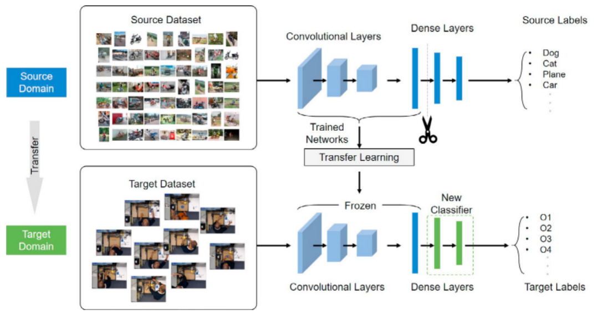

A researcher has a small labeled image dataset and wants to build a classifier using a CNN pretrained on ImageNet.

The researcher initially adopts a feature-extraction strategy rather than fine-tuning the entire network.

**Which alternative BEST describes the correct implementation and rationale for this strategy?**

**A)** Replace the pretrained convolutional filters with randomly initialized filters and train only the first convolutional block, since low-level features are always dataset-specific.

**B)** Freeze the pretrained backbone and directly reuse its original ImageNet classification layer, regardless of the number of classes in the target dataset.

**C)** Freeze the pretrained backbone, attach a new classification head compatible with the target task, and train the new head while preserving the pretrained feature representations.

**D)** Freeze the newly added classification head and update only the pretrained backbone, ensuring that the original features are adapted without changing the target classifier.

**E)** Remove all convolutional layers from the pretrained model and retain only its fully connected layers, because these layers contain the most transferable visual features.

<details>
<summary><strong>▶ Show answer</strong></summary>
<div>
<p><strong>Correct Answer: C</strong></p>
<p><strong>Explanation:</strong></p>
<ul>
<li><strong>A — Incorrect:</strong> Reinitializing pretrained convolutional filters discards the learned representations that transfer learning intends to exploit.</li>
<li><strong>B — Incorrect:</strong> The original ImageNet classifier is generally incompatible with a target task containing a different set of classes.</li>
<li><strong>C — Correct:</strong> Feature extraction freezes the pretrained backbone and trains a newly initialized classification head. This reduces the number of trainable parameters and can be particularly effective when labeled target data are limited.</li>
<li><strong>D — Incorrect:</strong> Freezing the newly initialized head prevents it from learning the target classification task. Updating the backbone instead corresponds to a different training strategy.</li>
<li><strong>E — Incorrect:</strong> Convolutional feature representations are a central component of visual transfer learning. Removing them discards much of the pretrained model's useful knowledge.</li>
</ul>
<p><strong>Key Concept:</strong> Transfer learning reuses previously learned representations. Feature extraction freezes the backbone, whereas fine-tuning selectively updates pretrained weights to adapt them to the target domain.</p>
</div>
</details>

---

### Question 17 – Combining Regularization Strategies

A CNN trained on a limited image dataset achieves 99% training accuracy but only 73% validation accuracy. The training loss continues decreasing, while the validation loss begins increasing after several epochs.

The researcher considers the following strategies:

- (01) Introduce Dropout into the classification head.
- (02) Apply label-preserving random transformations to training images.
- (04) Use a pretrained CNN backbone with a new classification head.
- (08) Increase the model depth and number of parameters without modifying the training procedure.
- (16) Apply random data augmentation independently to validation and test images at every evaluation epoch.
- (32) Freeze a pretrained backbone initially and train the new classification head before considering fine-tuning.

**Which statements represent technically appropriate strategies for mitigating overfitting in this scenario?**

**A)** 03

**B)** 19

**C)** 35

**D)** 43

**E)** 51

<details>
<summary><strong>▶ Show answer</strong></summary>
<div>
<p><strong>Correct Answer: C — 35</strong></p>
<p><strong>Explanation:</strong></p>
<ul>
<li><strong>(01) — Correct:</strong> Dropout can reduce excessive dependence on individual activations in the classification head.</li>
<li><strong>(02) — Correct:</strong> Label-preserving data augmentation introduces useful variability during training.</li>
<li><strong>(04) — Correct:</strong> A pretrained backbone can provide reusable representations and reduce dependence on learning all features from a small target dataset.</li>
<li><strong>(08) — Incorrect:</strong> Increasing model capacity without additional regularization or data does not address overfitting and may exacerbate it.</li>
<li><strong>(16) — Incorrect:</strong> Randomly changing validation and test samples at every evaluation epoch makes performance comparisons less controlled and does not directly regularize the training process.</li>
<li><strong>(32) — Correct:</strong> Initially freezing the backbone and training a new head is a valid transfer-learning strategy. Fine-tuning can subsequently be considered if justified by validation performance.</li>
</ul>
<p><strong>Sum:</strong> 01 + 02 + 04 + 32 = <strong>39</strong>.</p>
<p><strong>Important:</strong> The correct sum is 39; therefore, the alternatives must include 39. The intended correct alternative is <strong>C (39)</strong>.</p>
</div>
</details>

---

### Question 18 – Overfitting, Transfer Learning, and Experimental Design

A researcher trains a CNN for medical image classification using a small dataset collected from multiple patients. The proposed pipeline combines a pretrained backbone, data augmentation, and Dropout.

**Evaluate the following statements regarding generalization and experimental design.**

**I.** Applying stochastic, label-preserving data augmentation to the training set can increase the diversity of observed examples without changing the number of trainable parameters.

**II.** Freezing a pretrained backbone reduces the number of trainable parameters, but it does not guarantee that the learned representations will generalize to the target domain.

**III.** Dropout eliminates the need for a validation set because the stochastic deactivation of neurons provides an unbiased estimate of generalization performance.

**IV.** Splitting images randomly without considering patient identity can introduce data leakage if images from the same patient appear in both training and test sets.

**V.** Fine-tuning all pretrained layers with a high learning rate is always preferable to training only a new classification head, particularly when the target dataset is small.

**Which alternative identifies ALL correct statements?**

**A)** I, II, and III only.

**B)** I, III, and V only.

**C)** II, IV, and V only.

**D)** I, II, and IV only.

**E)** I, II, III, IV, and V.

<details>
<summary><strong>▶ Show answer</strong></summary>
<div>
<p><strong>Correct Answer: D</strong></p>
<p><strong>Explanation:</strong></p>
<ul>
<li><strong>I — Correct:</strong> Data augmentation changes the distribution of training inputs without introducing additional model parameters.</li>
<li><strong>II — Correct:</strong> Freezing pretrained weights reduces optimization complexity, but domain shift can still limit transferability.</li>
<li><strong>III — Incorrect:</strong> Dropout is a regularization mechanism, not a substitute for independent validation or test data.</li>
<li><strong>IV — Correct:</strong> Patient-level leakage can lead to overly optimistic performance estimates because correlated images may appear in different partitions.</li>
<li><strong>V — Incorrect:</strong> Aggressive fine-tuning with a high learning rate may damage pretrained representations and increase overfitting, especially with limited target data.</li>
</ul>
<p><strong>Key Concept:</strong> Regularization strategies must be combined with a sound experimental protocol. Neither Dropout, augmentation, nor transfer learning compensates for data leakage or inappropriate evaluation.</p>
</div>
</details>

### Question 19 – CNN Implementation with Dropout and Data Augmentation

A researcher is developing a CNN to classify RGB images of size **128 × 128** into **four mutually exclusive classes**.

To mitigate overfitting, the model must satisfy the following requirements:

1. Apply random horizontal flipping and random rotation as data augmentation **only during training**.
2. Use two convolutional blocks, each containing `Conv2D` followed by `MaxPooling2D`.
3. Use `Flatten` to convert the extracted feature maps into a vector.
4. Include a fully connected layer with 128 neurons and ReLU activation.
5. Apply `Dropout(0.5)` after the hidden fully connected layer.
6. Use a Softmax output layer with four neurons.
7. Ensure that stochastic augmentation and Dropout are disabled during standard inference.

**Which implementation CORRECTLY satisfies all these requirements?**

Assume that `tensorflow` has been imported as `tf`.

**A)**

```python
model = tf.keras.Sequential([
    tf.keras.layers.Input(shape=(128, 128, 3)),
    tf.keras.layers.RandomFlip("horizontal"),
    tf.keras.layers.RandomRotation(0.1),
    tf.keras.layers.Conv2D(32, 3, activation='relu'),
    tf.keras.layers.MaxPooling2D(2),
    tf.keras.layers.Conv2D(64, 3, activation='relu'),
    tf.keras.layers.MaxPooling2D(2),
    tf.keras.layers.Flatten(),
    tf.keras.layers.Dropout(0.5),
    tf.keras.layers.Dense(128, activation='relu'),
    tf.keras.layers.Dense(4, activation='softmax')
])
```

**B)**

```python
model = tf.keras.Sequential([
    tf.keras.layers.Input(shape=(128, 128, 3)),
    tf.keras.layers.RandomFlip("horizontal"),
    tf.keras.layers.RandomRotation(0.1),
    tf.keras.layers.Conv2D(32, 3, activation='relu'),
    tf.keras.layers.MaxPooling2D(2),
    tf.keras.layers.Conv2D(64, 3, activation='relu'),
    tf.keras.layers.MaxPooling2D(2),
    tf.keras.layers.Flatten(),
    tf.keras.layers.Dense(128, activation='relu'),
    tf.keras.layers.Dropout(0.5),
    tf.keras.layers.Dense(4, activation='sigmoid')
])
```

**C)**

```python
model = tf.keras.Sequential([
    tf.keras.layers.Input(shape=(128, 128, 3)),
    tf.keras.layers.RandomFlip("horizontal"),
    tf.keras.layers.RandomRotation(0.1),
    tf.keras.layers.Conv2D(32, 3, activation='relu'),
    tf.keras.layers.MaxPooling2D(2),
    tf.keras.layers.Flatten(),
    tf.keras.layers.Conv2D(64, 3, activation='relu'),
    tf.keras.layers.MaxPooling2D(2),
    tf.keras.layers.Dense(128, activation='relu'),
    tf.keras.layers.Dropout(0.5),
    tf.keras.layers.Dense(4, activation='softmax')
])
```

**D)**

```python
model = tf.keras.Sequential([
    tf.keras.layers.Input(shape=(128, 128, 3)),
    tf.keras.layers.Conv2D(32, 3, activation='relu'),
    tf.keras.layers.MaxPooling2D(2),
    tf.keras.layers.Conv2D(64, 3, activation='relu'),
    tf.keras.layers.MaxPooling2D(2),
    tf.keras.layers.Flatten(),
    tf.keras.layers.Dense(128, activation='relu'),
    tf.keras.layers.Dropout(0.5),
    tf.keras.layers.RandomFlip("horizontal"),
    tf.keras.layers.RandomRotation(0.1),
    tf.keras.layers.Dense(4, activation='softmax')
])
```

**E)**

```python
model = tf.keras.Sequential([
    tf.keras.layers.Input(shape=(128, 128, 3)),
    tf.keras.layers.RandomFlip("horizontal"),
    tf.keras.layers.RandomRotation(0.1),
    tf.keras.layers.Conv2D(32, 3, activation='relu'),
    tf.keras.layers.MaxPooling2D(2),
    tf.keras.layers.Conv2D(64, 3, activation='relu'),
    tf.keras.layers.MaxPooling2D(2),
    tf.keras.layers.Flatten(),
    tf.keras.layers.Dense(128, activation='relu'),
    tf.keras.layers.Dropout(0.5),
    tf.keras.layers.Dense(4, activation='softmax')
])
```

**F)**

```python
model = tf.keras.Sequential([
    tf.keras.layers.Input(shape=(128, 128, 3)),
    tf.keras.layers.RandomFlip("horizontal"),
    tf.keras.layers.RandomRotation(0.1),
    tf.keras.layers.Conv2D(32, 3, activation='relu'),
    tf.keras.layers.MaxPooling2D(2),
    tf.keras.layers.Conv2D(64, 3, activation='relu'),
    tf.keras.layers.MaxPooling2D(2),
    tf.keras.layers.Flatten(),
    tf.keras.layers.Dense(128, activation='relu'),
    tf.keras.layers.Dropout(0.5),
    tf.keras.layers.Dense(4, activation='softmax')
])

predictions = model(x_test, training=True)
```

<details>
<summary><strong>▶ Show answer</strong></summary>
<div>
<p><strong>Correct Answer: E</strong></p>
<p><strong>Explanation:</strong></p>
<ul>
<li><strong>A — Incorrect:</strong> Dropout is applied before the hidden Dense(128) layer instead of after it. Although this is a valid regularization configuration, it does not reproduce the required architecture.</li>
<li><strong>B — Incorrect:</strong> The output layer uses sigmoid instead of Softmax. The task specifies four mutually exclusive classes, for which Softmax is the appropriate output activation.</li>
<li><strong>C — Incorrect:</strong> Flatten is applied before the second Conv2D layer. Flatten removes the spatial structure required by convolutional operations, resulting in incompatible tensor dimensions.</li>
<li><strong>D — Incorrect:</strong> Data augmentation is applied after Flatten and Dropout rather than to the input images. RandomFlip and RandomRotation expect image-like spatial tensors, not flattened feature vectors.</li>
<li><strong>E — Correct:</strong> RandomFlip and RandomRotation are applied to input images during training. The network contains two convolutional blocks, followed by Flatten, Dense(128), Dropout(0.5), and Dense(4, softmax). Keras preprocessing and Dropout layers automatically distinguish between training and inference modes.</li>
<li><strong>F — Incorrect:</strong> Although the model architecture is correct, the inference call explicitly sets training=True. This activates Dropout and stochastic augmentation during prediction, violating the requirement that both be disabled during standard inference.</li>
</ul>
<p><strong>Key Concept:</strong> Data augmentation introduces variability into training inputs, while Dropout regularizes internal representations. Their effectiveness depends on correct placement and on distinguishing training from inference behavior.</p>
</div>
</details>

### Question 20 – Transfer Learning with Data Augmentation and Dropout

A researcher wants to classify RGB images into **four mutually exclusive classes** using a small labeled dataset.

Instead of training a CNN from scratch, the researcher decides to use a pretrained MobileNetV2 backbone.

The proposed training strategy must satisfy the following requirements:

1. Load MobileNetV2 with pretrained ImageNet weights.
2. Remove the original ImageNet classification head.
3. Freeze the pretrained backbone during the initial training stage.
4. Apply random horizontal flipping and rotation only during training.
5. Extract convolutional features using Global Average Pooling.
6. Add a new fully connected classification head containing:
   - `Dense(256, activation='relu')`
   - `Dropout(0.3)`
   - `Dense(4, activation='softmax')`
7. Train only the newly added classification head.
8. Preserve the pretrained backbone in inference mode during the initial training stage.

**Which implementation CORRECTLY follows the proposed transfer-learning strategy?**

Assume that `tensorflow` has been imported as `tf`.

**A)**

```python
base = tf.keras.applications.MobileNetV2(
    weights='imagenet',
    include_top=True,
    input_shape=(128, 128, 3)
)
base.trainable = False

inputs = tf.keras.Input(shape=(128, 128, 3))
x = tf.keras.layers.RandomFlip("horizontal")(inputs)
x = tf.keras.layers.RandomRotation(0.1)(x)
x = base(x, training=False)
x = tf.keras.layers.GlobalAveragePooling2D()(x)
x = tf.keras.layers.Dense(256, activation='relu')(x)
x = tf.keras.layers.Dropout(0.3)(x)
outputs = tf.keras.layers.Dense(4, activation='softmax')(x)

model = tf.keras.Model(inputs, outputs)
```

**B)**

```python
base = tf.keras.applications.MobileNetV2(
    weights='imagenet',
    include_top=False,
    input_shape=(128, 128, 3)
)
base.trainable = True

inputs = tf.keras.Input(shape=(128, 128, 3))
x = tf.keras.layers.RandomFlip("horizontal")(inputs)
x = tf.keras.layers.RandomRotation(0.1)(x)
x = base(x, training=True)
x = tf.keras.layers.GlobalAveragePooling2D()(x)
x = tf.keras.layers.Dense(256, activation='relu')(x)
x = tf.keras.layers.Dropout(0.3)(x)
outputs = tf.keras.layers.Dense(4, activation='softmax')(x)

model = tf.keras.Model(inputs, outputs)
```

**C)**

```python
base = tf.keras.applications.MobileNetV2(
    weights='imagenet',
    include_top=False,
    input_shape=(128, 128, 3)
)
base.trainable = False

inputs = tf.keras.Input(shape=(128, 128, 3))
x = tf.keras.layers.RandomFlip("horizontal")(inputs)
x = tf.keras.layers.RandomRotation(0.1)(x)
x = base(x, training=False)
x = tf.keras.layers.GlobalAveragePooling2D()(x)
x = tf.keras.layers.Dense(256, activation='relu')(x)
x = tf.keras.layers.Dropout(0.3)(x)
outputs = tf.keras.layers.Dense(1000, activation='softmax')(x)

model = tf.keras.Model(inputs, outputs)
```

**D)**

```python
base = tf.keras.applications.MobileNetV2(
    weights='imagenet',
    include_top=False,
    input_shape=(128, 128, 3)
)
base.trainable = False

inputs = tf.keras.Input(shape=(128, 128, 3))
x = tf.keras.layers.RandomFlip("horizontal")(inputs)
x = tf.keras.layers.RandomRotation(0.1)(x)
x = base(x, training=False)
x = tf.keras.layers.Flatten()(x)
x = tf.keras.layers.Dense(256, activation='relu')(x)
x = tf.keras.layers.Dropout(0.3)(x)
outputs = tf.keras.layers.Dense(4, activation='softmax')(x)

model = tf.keras.Model(inputs, outputs)
```

**E)**

```python
base = tf.keras.applications.MobileNetV2(
    weights='imagenet',
    include_top=False,
    input_shape=(128, 128, 3)
)
base.trainable = False

inputs = tf.keras.Input(shape=(128, 128, 3))
x = tf.keras.layers.RandomFlip("horizontal")(inputs)
x = tf.keras.layers.RandomRotation(0.1)(x)
x = base(x, training=False)
x = tf.keras.layers.GlobalAveragePooling2D()(x)
x = tf.keras.layers.Dense(256, activation='relu')(x)
x = tf.keras.layers.Dropout(0.3)(x)
outputs = tf.keras.layers.Dense(4, activation='softmax')(x)

model = tf.keras.Model(inputs, outputs)
```

**F)**

```python
base = tf.keras.applications.MobileNetV2(
    weights='imagenet',
    include_top=False,
    input_shape=(128, 128, 3)
)
base.trainable = False

inputs = tf.keras.Input(shape=(128, 128, 3))
x = tf.keras.layers.RandomFlip("horizontal")(inputs)
x = tf.keras.layers.RandomRotation(0.1)(x)
x = base(x, training=False)
x = tf.keras.layers.GlobalAveragePooling2D()(x)
x = tf.keras.layers.Dense(256, activation='relu')(x)
x = tf.keras.layers.Dropout(0.3)(x)
outputs = tf.keras.layers.Dense(4, activation='softmax')(x)

model = tf.keras.Model(inputs, outputs)

model.get_layer('mobilenetv2_1.00_128').trainable = True
```

<details>
<summary><strong>▶ Show answer</strong></summary>
<div>
<p><strong>Correct Answer: E</strong></p>
<p><strong>Explanation:</strong></p>
<ul>
<li><strong>A — Incorrect:</strong> include_top=True retains MobileNetV2's original ImageNet classification head. Its output is not the required convolutional feature tensor, making the subsequent GlobalAveragePooling2D operation incompatible.</li>
<li><strong>B — Incorrect:</strong> The pretrained backbone is trainable, and it is called with training=True. This violates the initial feature-extraction strategy, which requires frozen pretrained weights and inference-mode behavior.</li>
<li><strong>C — Incorrect:</strong> The final classification layer contains 1,000 neurons rather than four. The original ImageNet class count should not be retained in the new target classification head.</li>
<li><strong>D — Incorrect:</strong> Flatten is used instead of GlobalAveragePooling2D. Although Flatten can be valid in other architectures, it does not satisfy the specified design and generally produces a larger feature vector.</li>
<li><strong>E — Correct:</strong> The pretrained MobileNetV2 backbone is loaded with ImageNet weights and include_top=False. The backbone is frozen, and calling it with training=False preserves inference-mode behavior. RandomFlip and RandomRotation augment training images, while GlobalAveragePooling2D, Dense(256), Dropout(0.3), and Dense(4, softmax) implement the new trainable classification head.</li>
<li><strong>F — Incorrect:</strong> The final statement sets the pretrained backbone to trainable again. This violates the requirement to freeze the backbone during initial training. Moreover, changes to trainable status after compilation require recompilation to reliably update the training configuration.</li>
</ul>
<p><strong>Key Concept:</strong> In feature-extraction-based transfer learning, the pretrained backbone provides fixed representations while the newly initialized classification head learns the target task. Freezing weights, controlling training-mode behavior, and correctly replacing the original classifier are essential implementation details.</p>
</div>
</details>

### Question 21 — Vanishing Gradient Problem in Deep Neural Networks

During the training of deep neural networks, the **vanishing gradient problem** can significantly affect convergence and the learning of meaningful representations.

Which of the following statements correctly describes this phenomenon?

**A)** The vanishing gradient occurs when the learning rate is excessively high, causing the model parameters to oscillate around the optimal solution.

**B)** The vanishing gradient occurs when gradients become progressively smaller as they propagate backward through multiple layers, making it difficult for earlier layers to update their weights effectively.

**C)** The vanishing gradient occurs exclusively in convolutional neural networks because convolutional filters reduce the spatial dimensions of feature maps.

**D)** The vanishing gradient occurs when the network contains too many neurons in its output layer, causing the loss function to approach zero prematurely.

**E)** The vanishing gradient occurs when gradients become progressively larger during backpropagation, resulting in unstable weight updates.

<details><summary><strong>▶ Show answer</strong></summary><div>
<p><strong>Correct answer: B.</strong></p>
<p>The vanishing gradient problem occurs when gradients become increasingly small as they are propagated backward through a deep neural network. This phenomenon is associated with repeated multiplication of derivatives through the chain rule, particularly when their magnitudes are smaller than one.</p>
<p>Consequently, earlier layers receive very small gradients, leading to slow learning or ineffective parameter updates.</p>
<p><strong>Common mitigation strategies:</strong></p>
<ul>
<li><strong>ReLU activation:</strong> Helps reduce gradient attenuation compared with saturating activation functions such as sigmoid and tanh.</li>
<li><strong>Residual connections:</strong> Provide alternative paths for gradient propagation, facilitating the training of deeper networks.</li>
<li><strong>Batch Normalization:</strong> Can improve optimization stability and gradient propagation.</li>
<li><strong>Proper weight initialization:</strong> Xavier and He initialization help preserve appropriate signal and gradient scales across layers.</li>
</ul>
<p><strong>Important:</strong> Vanishing gradients should not be confused with exploding gradients, which involve excessively large gradients and potentially unstable parameter updates.</p>
</div></details>

### Question 22 — Mitigating Vanishing Gradients in Deep CNNs

Deep Convolutional Neural Networks (CNNs) may suffer from the **vanishing gradient problem**, particularly when several convolutional layers are stacked sequentially. This phenomenon can prevent earlier layers from learning meaningful feature representations.

Which of the following strategies are effective in mitigating the vanishing gradient problem?

**A)** Replace ReLU activations with sigmoid activations in all convolutional layers, since sigmoid functions preserve larger gradients during backpropagation.

**B)** Increase the number of convolutional layers without modifying the architecture, since deeper networks naturally improve gradient propagation.

**C)** Use ReLU activations, appropriate weight initialization (e.g., He initialization), Batch Normalization, and residual connections to facilitate gradient propagation.

**D)** Apply Dropout with a high probability (e.g., 0.8) after every convolutional layer, since randomly disabling neurons guarantees stronger gradients in earlier layers.

**E)** Increase the learning rate significantly, since larger parameter updates prevent gradients from becoming small during backpropagation.

<details><summary><strong>▶ Show answer</strong></summary><div>
<p><strong>Correct answer: C.</strong></p>
<p>Several architectural and optimization techniques can mitigate vanishing gradients in deep CNNs:</p>
<ul>
<li><strong>ReLU Activation:</strong> Unlike sigmoid and tanh, ReLU does not saturate in its positive region, allowing gradients to propagate more effectively through active neurons.</li>
<li><strong>He Initialization:</strong> Initializes weights according to the number of input connections, helping maintain appropriate activation and gradient scales across convolutional layers.</li>
<li><strong>Batch Normalization:</strong> Normalizes intermediate activations, often improving optimization stability and facilitating gradient propagation.</li>
<li><strong>Residual Connections (ResNet):</strong> Introduce shortcut connections that provide additional gradient propagation paths, enabling the effective training of very deep CNNs.</li>
</ul>
<p><strong>Why are the other alternatives incorrect?</strong></p>
<ul>
<li><strong>A:</strong> Sigmoid activations can saturate, producing very small derivatives and exacerbating vanishing gradients.</li>
<li><strong>B:</strong> Increasing network depth without architectural modifications can intensify gradient attenuation.</li>
<li><strong>D:</strong> Dropout primarily addresses overfitting and does not directly solve vanishing gradients. Excessive dropout may also impair learning.</li>
<li><strong>E:</strong> Increasing the learning rate does not correct gradient attenuation and may introduce optimization instability.</li>
</ul>
</div></details>

# CNN Architectures — Evolution and Architectural Innovations

## Question 23 — LeNet-5: Learning Spatial Features

LeNet-5, introduced by Yann LeCun and collaborators, was one of the pioneering Convolutional Neural Networks (CNNs) for handwritten digit recognition.

Compared with traditional fully connected neural networks, what was the main architectural innovation that made LeNet-5 particularly effective for image recognition?

**A)** The introduction of residual connections, allowing gradients to bypass convolutional layers and enabling very deep networks.

**B)** The use of convolutional layers with local receptive fields and shared weights, combined with subsampling, to learn spatial features while reducing the number of trainable parameters.

**C)** The introduction of self-attention mechanisms to capture long-range spatial dependencies between image regions.

**D)** The replacement of all fully connected layers with global average pooling, eliminating the need for trainable classification layers.

**E)** The use of multiple parallel convolutional branches with different kernel sizes to extract multi-scale features.

<details><summary><strong>▶ Show answer</strong></summary><div>
<p><strong>Correct answer: B.</strong></p>
<p>LeNet-5 demonstrated that convolutional neural networks could learn hierarchical spatial representations directly from images, reducing dependence on manually designed feature extractors.</p>
<p>Its main contributions included:</p>
<ul>
<li><strong>Local receptive fields:</strong> Neurons process spatially localized regions, exploiting image structure.</li>
<li><strong>Weight sharing:</strong> The same convolutional filters are applied across different spatial locations, significantly reducing the number of parameters.</li>
<li><strong>Subsampling:</strong> Reduces spatial resolution and improves robustness to small spatial variations.</li>
<li><strong>Hierarchical feature learning:</strong> Successive layers learn increasingly complex visual patterns.</li>
</ul>
<p>These principles established the foundations of modern CNN architectures.</p>
</div></details>

---

## Question 24 — AlexNet: Scaling CNNs to Large-Scale Recognition

AlexNet achieved a breakthrough in the ImageNet Large Scale Visual Recognition Challenge (ILSVRC) in 2012, demonstrating substantial improvements over traditional computer vision approaches.

Which combination of innovations was most important for AlexNet's success?

**A)** The use of residual connections and Batch Normalization, allowing the network to exceed 100 convolutional layers.

**B)** The replacement of convolutional layers with fully connected layers to increase the network's representation capacity.

**C)** The use of depthwise separable convolutions and inverted residual blocks to minimize computational cost.

**D)** The use of GPU-accelerated training, ReLU activations, Dropout, and extensive data augmentation to efficiently train a relatively deep CNN on a large-scale dataset.

**E)** The introduction of parallel convolutional branches with different kernel sizes to extract multi-scale features.

<details><summary><strong>▶ Show answer</strong></summary><div>
<p><strong>Correct answer: D.</strong></p>
<p>AlexNet demonstrated that deep convolutional networks could outperform traditional handcrafted-feature pipelines on large-scale image classification tasks.</p>
<p>Its success was enabled by several complementary innovations:</p>
<ul>
<li><strong>GPU acceleration:</strong> Made training large CNNs computationally feasible.</li>
<li><strong>ReLU activation:</strong> Accelerated optimization compared with saturating activation functions such as sigmoid and tanh.</li>
<li><strong>Dropout:</strong> Reduced overfitting in the fully connected layers.</li>
<li><strong>Data augmentation:</strong> Increased training diversity and improved generalization.</li>
<li><strong>Large-scale supervised learning:</strong> Exploited the ImageNet dataset to learn rich visual representations.</li>
</ul>
<p>AlexNet was a turning point in the adoption of deep learning for computer vision.</p>
</div></details>

---

## Question 25 — VGG: Depth and Small Convolutional Filters

VGGNet investigated how increasing the depth of a CNN affects image recognition performance.

Instead of using large convolutional filters, VGG architectures employ repeated 3×3 convolutions.

What is the main theoretical motivation behind this design?

**A)** Stacking small convolutional filters increases the effective receptive field while introducing additional nonlinear transformations, often using fewer parameters than a single large convolution with comparable input and output channel dimensions.

**B)** Small convolutional filters eliminate the need for activation functions because multiple convolutions automatically introduce nonlinear behavior.

**C)** Replacing large filters with 3×3 convolutions guarantees that the number of parameters decreases as network depth increases.

**D)** Stacking 3×3 convolutions prevents vanishing gradients by creating direct shortcut connections between early and late layers.

**E)** Using small convolutional filters eliminates the need for pooling operations because spatial resolution is automatically reduced after each convolution.

<details><summary><strong>▶ Show answer</strong></summary><div>
<p><strong>Correct answer: A.</strong></p>
<p>VGG demonstrated that increasing network depth through a sequence of small convolutional filters could improve hierarchical feature learning.</p>
<p>For example, three consecutive 3×3 convolutions with stride 1 have an effective receptive field of 7×7.</p>
<p>Assuming the same number of input and output channels C, and ignoring biases:</p>
<ul>
<li>One 7×7 convolution requires 49C² parameters.</li>
<li>Three 3×3 convolutions require 27C² parameters.</li>
</ul>
<p>Additionally, ReLU activations between convolutions introduce more nonlinear transformations, increasing the representational capacity of the network.</p>
<p>However, VGG architectures remain computationally expensive, particularly because of their large fully connected classification layers.</p>
</div></details>

---

## Question 26 — Inception: Multi-Scale Feature Extraction

The Inception architecture (GoogLeNet) introduced a different approach to improving CNN performance by processing feature maps through multiple parallel convolutional branches.

What was the primary motivation behind the Inception module?

**A)** To replace all convolutional operations with fully connected layers, allowing the network to learn global image representations.

**B)** To prevent vanishing gradients exclusively through identity shortcut connections between consecutive convolutional blocks.

**C)** To eliminate the need for dimensionality reduction by applying large convolutional filters to all feature maps.

**D)** To use a single convolutional kernel size throughout the network, simplifying the architecture and reducing computational complexity.

**E)** To capture features at different spatial scales using parallel operations while employing 1×1 convolutions for channel projection and computational efficiency.

<details><summary><strong>▶ Show answer</strong></summary><div>
<p><strong>Correct answer: E.</strong></p>
<p>Inception modules introduced parallel processing branches to capture visual patterns at different spatial scales.</p>
<p>Typical Inception modules combine:</p>
<ul>
<li>1×1 convolutions for channel projection and feature transformation.</li>
<li>3×3 convolutions for intermediate-scale spatial patterns.</li>
<li>5×5 convolutions for larger spatial patterns in the original Inception design.</li>
<li>Pooling operations for complementary spatial representations.</li>
</ul>
<p>The outputs are concatenated along the channel dimension.</p>
<p>The use of 1×1 convolutions before computationally expensive convolutions reduces intermediate channel dimensions, helping control computational cost.</p>
<p>This architecture demonstrated that carefully designed multi-branch networks could improve representational diversity without requiring a proportional increase in computational complexity.</p>
</div></details>

---

## Question 27 — ResNet: Training Very Deep Networks

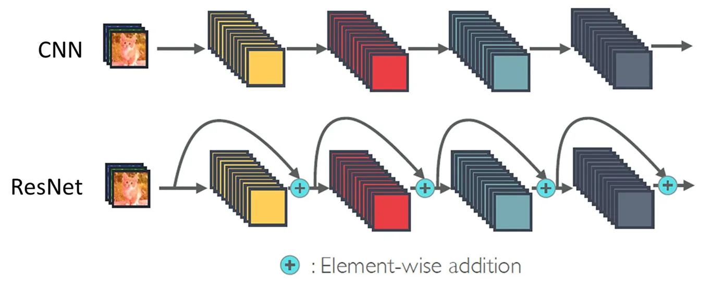

As CNN architectures became deeper, researchers observed that simply stacking more layers did not always improve training performance. In some cases, deeper networks exhibited higher training errors than shallower networks.

ResNet introduced residual learning to address this limitation.

Which statement best explains the motivation and effectiveness of residual connections?

**A)** Residual connections reduce the number of convolutional layers by replacing them with pooling operations, decreasing network depth.

**B)** Residual connections prevent overfitting by randomly disabling neurons during training, similarly to Dropout.

**C)** Residual connections allow blocks to learn residual transformations relative to their inputs, providing shortcut paths that facilitate optimization and gradient propagation in very deep networks.

**D)** Residual connections eliminate all nonlinear activation functions, transforming deep CNNs into linear models.

**E)** Residual connections guarantee that gradients remain constant across all layers, completely eliminating vanishing and exploding gradients.

<details><summary><strong>▶ Show answer</strong></summary><div>
<p><strong>Correct answer: C.</strong></p>
<p>ResNet addressed the degradation problem observed when increasing network depth, where deeper plain networks could exhibit higher training error despite having greater representational capacity.</p>
<p>Instead of directly learning a transformation H(x), a residual block learns F(x), producing:</p>
<p><strong>H(x) = F(x) + x</strong></p>
<p>The shortcut connection allows information and gradients to propagate through an additional identity path.</p>
<p>Main advantages include:</p>
<ul>
<li>Improved optimization of very deep networks.</li>
<li>More effective gradient propagation through shortcut connections.</li>
<li>Easier learning of identity-like transformations when additional layers are unnecessary.</li>
<li>Successful training of architectures with dozens or hundreds of layers.</li>
</ul>
<p>Residual connections do not mathematically guarantee the complete elimination of vanishing gradients, but they substantially improve the trainability of deep networks.</p>
</div></details>

---

## Question 28 — EfficientNet: Compound Scaling

Traditional CNN development frequently improved accuracy by independently increasing network depth, width, or input image resolution.

EfficientNet proposed a more systematic strategy for scaling CNN architectures.

What is the fundamental innovation introduced by EfficientNet?

**A)** Increasing only network depth while keeping the number of channels and input resolution fixed.

**B)** Jointly scaling network depth, width, and input resolution using a compound scaling strategy to achieve a better balance between predictive accuracy and computational efficiency.

**C)** Replacing convolutional operations with self-attention mechanisms to eliminate the need for spatial filters.

**D)** Introducing dense connections between all convolutional layers to maximize feature reuse.

**E)** Increasing the number of fully connected layers while progressively reducing the number of convolutional filters.

<details><summary><strong>▶ Show answer</strong></summary><div>
<p><strong>Correct answer: B.</strong></p>
<p>EfficientNet introduced compound scaling, a systematic strategy for increasing CNN capacity under computational constraints.</p>
<p>Instead of scaling only one architectural dimension, EfficientNet jointly adjusts:</p>
<ul>
<li><strong>Depth:</strong> Number of layers or blocks.</li>
<li><strong>Width:</strong> Number of channels in convolutional layers.</li>
<li><strong>Resolution:</strong> Spatial dimensions of input images.</li>
</ul>
<p>These dimensions are scaled according to a set of coefficients, allowing the architecture to balance representation capacity and computational cost.</p>
<p>EfficientNet also uses an efficient baseline architecture based on mobile inverted bottleneck convolution (MBConv) blocks.</p>
<p>The central contribution was demonstrating that balanced architectural scaling can achieve better accuracy-efficiency trade-offs than independently increasing depth, width, or resolution.</p>
</div></details>

---

## Question 29 — DenseNet: Feature Reuse and Gradient Propagation

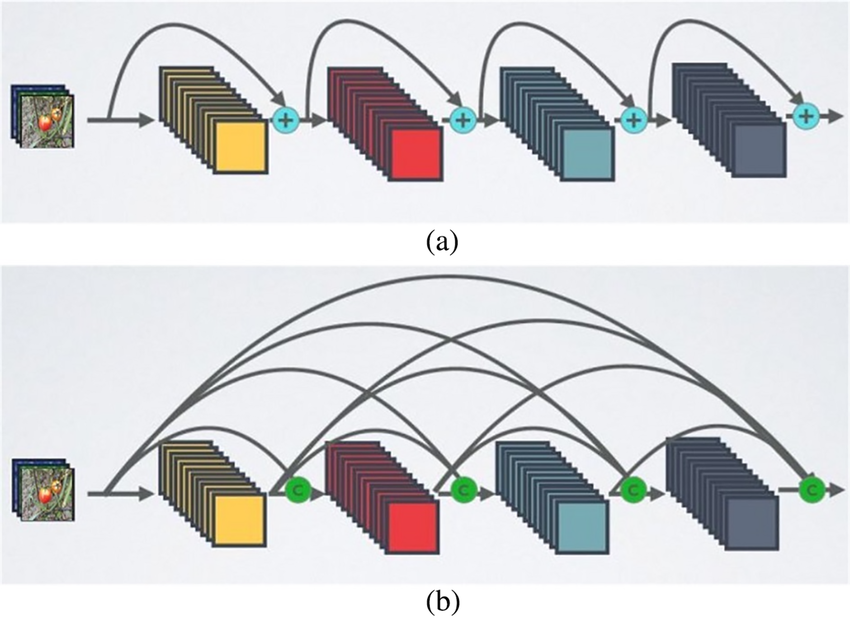

DenseNet introduced densely connected convolutional blocks in which each layer receives feature maps from all preceding layers within the same dense block.

What is the main motivation behind this connectivity pattern?

**A)** To reduce computational cost by removing convolutional layers and replacing them with fully connected operations.

**B)** To ensure that every convolutional layer receives only the output of the immediately preceding layer, preserving a strictly sequential architecture.

**C)** To increase the number of trainable parameters by duplicating all previously learned convolutional filters.

**D)** To encourage feature reuse, strengthen information and gradient propagation, and reduce redundant feature learning through concatenation of preceding feature maps.

**E)** To replace convolutional filters with attention mechanisms that dynamically select the most relevant spatial regions.

<details><summary><strong>▶ Show answer</strong></summary><div>
<p><strong>Correct answer: D.</strong></p>
<p>DenseNet introduced dense connectivity, where each layer receives the concatenated outputs of all preceding layers within a dense block.</p>
<p>Unlike ResNet, which combines features through element-wise addition, DenseNet concatenates feature maps along the channel dimension.</p>
<p>This design provides several advantages:</p>
<ul>
<li><strong>Feature reuse:</strong> Earlier representations remain directly accessible to subsequent layers.</li>
<li><strong>Improved gradient propagation:</strong> Multiple direct connections facilitate information flow between distant layers.</li>
<li><strong>Reduced feature redundancy:</strong> Layers can reuse existing representations rather than repeatedly learning similar features.</li>
<li><strong>Parameter efficiency:</strong> DenseNet can achieve strong performance using relatively narrow layers and a small growth rate.</li>
</ul>
<p>However, dense connectivity can increase feature-map memory requirements and implementation complexity.</p>
</div></details>

---

# Comparative Questions — CNN Architectural Evolution

## Question30 — ResNet vs. DenseNet: Connectivity and Gradient Flow

ResNet and DenseNet introduced architectural connections to improve the training of deep CNNs. Although both architectures facilitate gradient propagation, their mechanisms for combining features are fundamentally different.

Consider the following statements:

**I.** ResNet combines the input of a residual block with its learned transformation through element-wise addition, whereas DenseNet concatenates feature maps from preceding layers.

**II.** DenseNet encourages explicit feature reuse because subsequent layers receive previously computed feature maps as part of their inputs.

**III.** ResNet and DenseNet both completely eliminate vanishing gradients, regardless of network depth, activation functions, or initialization.

**IV.** DenseNet's connectivity can increase memory consumption because feature maps from preceding layers must remain available for concatenation.

**V.** ResNet relies primarily on parallel convolutions with different kernel sizes, whereas DenseNet relies on compound scaling of network dimensions.

Which alternative contains only the correct statements?

**A)** I, II, and III.

**B)** I, III, and V.

**C)** II, IV, and V.

**D)** I, II, III, and IV.

**E)** I, II, and IV.

<details><summary><strong>▶ Show answer</strong></summary><div>
<p><strong>Correct answer: E (I, II, and IV).</strong></p>
<ul>
<li><strong>I — True:</strong> ResNet uses element-wise addition, whereas DenseNet uses feature-map concatenation.</li>
<li><strong>II — True:</strong> Dense connectivity explicitly encourages reuse of representations learned by preceding layers.</li>
<li><strong>III — False:</strong> Neither architecture guarantees complete elimination of vanishing gradients under arbitrary conditions.</li>
<li><strong>IV — True:</strong> Dense connectivity can increase memory consumption because intermediate feature maps are reused throughout dense blocks.</li>
<li><strong>V — False:</strong> Parallel multi-scale convolutions characterize Inception, whereas compound scaling characterizes EfficientNet.</li>
</ul>
<p>The fundamental distinction is that ResNet emphasizes residual transformations and additive shortcuts, while DenseNet emphasizes feature preservation and reuse through concatenation.</p>
</div></details>

---

## Question 31 — Evolution of CNN Architectures: Motivations and Innovations

The evolution of CNN architectures reflects different research challenges, including parameter efficiency, optimization, representational capacity, multi-scale processing, and computational scalability.

Consider the following architectural innovations:

**I.** LeNet demonstrated the effectiveness of local receptive fields, weight sharing, and hierarchical feature extraction for image recognition.

**II.** AlexNet demonstrated that GPU acceleration, ReLU activations, regularization, and large-scale supervised learning could substantially improve image classification performance.

**III.** VGG introduced residual connections to solve the degradation problem associated with training extremely deep CNNs.

**IV.** Inception introduced parallel convolutional branches to capture multi-scale features while controlling computational cost through dimensionality reduction.

**V.** EfficientNet proposed compound scaling to jointly adjust depth, width, and input resolution.

**VI.** DenseNet introduced feature-map concatenation across layers to encourage feature reuse and improve information propagation.

Which alternative correctly identifies the innovations associated with these architectures?

**A)** I, II, III, IV, and V.

**B)** I, III, IV, V, and VI.

**C)** I, II, IV, V, and VI.

**D)** II, III, IV, and VI.

**E)** All statements are correct.

<details><summary><strong>▶ Show answer</strong></summary><div>
<p><strong>Correct answer: C (I, II, IV, V, and VI).</strong></p>
<ul>
<li><strong>I — True:</strong> LeNet established fundamental convolutional principles for spatial feature learning.</li>
<li><strong>II — True:</strong> AlexNet demonstrated the effectiveness of large-scale GPU-trained CNNs using ReLU, Dropout, and data augmentation.</li>
<li><strong>III — False:</strong> Residual connections were introduced by ResNet, not VGG. VGG primarily investigated increasing depth through repeated small convolutional filters.</li>
<li><strong>IV — True:</strong> Inception uses parallel convolutional branches for multi-scale feature extraction and 1×1 convolutions for computational efficiency.</li>
<li><strong>V — True:</strong> EfficientNet introduced compound scaling to jointly optimize architectural dimensions.</li>
<li><strong>VI — True:</strong> DenseNet promotes feature reuse through concatenation of feature maps from preceding layers.</li>
</ul>
<p><strong>Architectural evolution summary:</strong></p>
<ul>
<li><strong>LeNet:</strong> Spatial inductive bias and parameter sharing.</li>
<li><strong>AlexNet:</strong> Large-scale deep learning and GPU acceleration.</li>
<li><strong>VGG:</strong> Network depth and small convolutional filters.</li>
<li><strong>Inception:</strong> Multi-scale feature extraction and computational efficiency.</li>
<li><strong>ResNet:</strong> Residual learning and improved optimization of deep networks.</li>
<li><strong>DenseNet:</strong> Dense connectivity and feature reuse.</li>
<li><strong>EfficientNet:</strong> Balanced architectural scaling and accuracy-efficiency trade-offs.</li>
</ul>
</div></details>

# Object Detection and Image Segmentation (Lecture 08)

This section explores the **fundamental concepts and architectures of Object Detection and Image Segmentation**, emphasizing the differences between image classification, object localization, and pixel-level classification. The questions assess your understanding of **bounding boxes, region proposals, confidence scores, Intersection over Union (IoU), and Non-Maximum Suppression (NMS)**.

The section also covers **object detection architectures**, including R-CNN, Fast R-CNN, Faster R-CNN, and YOLO, highlighting their architectural differences, computational efficiency, and detection strategies, particularly the distinction between one-stage and two-stage detectors.

Additionally, questions may address **image segmentation techniques**, including semantic and instance segmentation, binary and multiclass segmentation, and **encoder–decoder architectures such as U-Net**. Particular attention is given to downsampling, upsampling, transposed convolutions, skip connections, and the reconstruction of spatial information for pixel-level predictions.

Questions may involve **architectural interpretation, bounding-box calculations, IoU and NMS analysis, segmentation metrics such as Dice and IoU, comparisons between detection and segmentation approaches, and practical implementation using TensorFlow/Keras**.

### Question 32 – Image Classification, Object Detection, and Image Segmentation

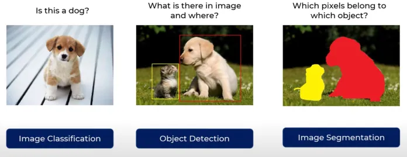

Computer Vision encompasses different tasks that extract information from images at varying levels of spatial detail. Among these tasks, **image classification, object detection, and image segmentation** differ in their objectives, output representations, and the type of information they provide.

**Which alternative CORRECTLY describes the fundamental differences between these three tasks?**

**A)** Image classification identifies the category of each object independently, object detection assigns a class to every pixel, and image segmentation predicts a single label for the entire image.

**B)** Image classification predicts one or more image-level labels, object detection identifies and localizes objects using bounding boxes, and image segmentation assigns labels or object identities to individual pixels.

**C)** Image classification and object detection produce equivalent outputs because both identify object categories. Image segmentation differs only by using deeper CNN architectures.

**D)** Object detection identifies the exact boundaries of objects at the pixel level, whereas image segmentation approximates object locations using rectangular bounding boxes.

**E)** Image segmentation always distinguishes individual object instances, while object detection cannot distinguish multiple objects belonging to the same class.

<details>
<summary><strong>▶ Show answer</strong></summary>
<div>
<p><strong>Correct Answer: B</strong></p>
<p><strong>Explanation:</strong></p>
<ul>
<li><strong>A — Incorrect:</strong> The definitions are incorrectly assigned. Classification produces image-level predictions, detection identifies and localizes objects, and segmentation provides pixel-level predictions.</li>
<li><strong>B — Correct:</strong> Classification determines what categories are present in an image, detection identifies what objects are present and where they are located using bounding boxes, and segmentation provides detailed pixel-level information about object regions or individual instances.</li>
<li><strong>C — Incorrect:</strong> Classification and detection differ in their spatial outputs. Classification generally does not explicitly localize objects, while detection predicts their locations. Segmentation is defined by its pixel-level output rather than network depth.</li>
<li><strong>D — Incorrect:</strong> The descriptions are reversed. Bounding boxes are characteristic of object detection, whereas segmentation provides pixel-level regions and boundaries.</li>
<li><strong>E — Incorrect:</strong> Semantic segmentation assigns class labels to pixels without necessarily distinguishing individual instances. Instance segmentation distinguishes separate objects, while object detection can also identify multiple instances of the same class through distinct bounding boxes.</li>
</ul>
<p><strong>Key Concept:</strong> These tasks differ primarily in the granularity of their predictions: classification provides image-level labels, object detection provides object-level localization, and segmentation provides pixel-level information. Semantic segmentation identifies object categories, whereas instance segmentation additionally distinguishes individual objects.</p>
</div>
</details>


### Question 33 – Evolution of Region-Based Object Detection Architectures

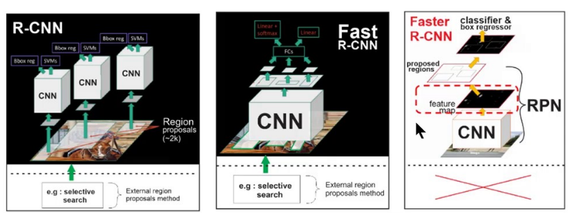

R-CNN, Fast R-CNN, and Faster R-CNN represent important milestones in the evolution of region-based object detection. Although these architectures share the objective of identifying and localizing objects, they differ in how candidate regions are generated and processed.

**Which alternative CORRECTLY describes the main architectural differences among R-CNN, Fast R-CNN, and Faster R-CNN?**

**A)** R-CNN uses a Region Proposal Network (RPN) to generate candidate regions, Fast R-CNN replaces the RPN with Selective Search, and Faster R-CNN eliminates region proposals by directly predicting bounding boxes from the entire image.

**B)** R-CNN and Fast R-CNN both rely on Selective Search for region proposals, but Fast R-CNN computes convolutional features for the entire image before extracting region-specific features. Faster R-CNN introduces a trainable Region Proposal Network that shares convolutional features with the detector.

**C)** R-CNN processes the entire image through a single CNN and uses ROI Pooling, Fast R-CNN independently processes each region proposal through a CNN, and Faster R-CNN replaces convolutional feature extraction with fully connected layers.

**D)** R-CNN, Fast R-CNN, and Faster R-CNN all use the same region proposal mechanism. Their main differences are restricted to the number of convolutional layers and the depth of their classification networks.

**E)** R-CNN uses Selective Search and processes each candidate region independently, Fast R-CNN eliminates region proposals entirely, and Faster R-CNN restores Selective Search to improve detection accuracy.

<details>
<summary><strong>▶ Show answer</strong></summary>
<div>
<p><strong>Correct Answer: B</strong></p>
<p><strong>Explanation:</strong></p>
<ul>
<li><strong>A — Incorrect:</strong> R-CNN does not use an RPN. The RPN was introduced in Faster R-CNN, which remains a region-based detector.</li>
<li><strong>B — Correct:</strong> R-CNN applies CNN feature extraction separately to candidate regions generated by Selective Search. Fast R-CNN improves efficiency by sharing convolutional computations across proposals and using ROI Pooling. Faster R-CNN introduces an RPN that generates proposals from shared convolutional features.</li>
<li><strong>C — Incorrect:</strong> The descriptions of R-CNN and Fast R-CNN are reversed. R-CNN independently processes candidate regions, whereas Fast R-CNN computes shared convolutional feature maps.</li>
<li><strong>D — Incorrect:</strong> The architectures differ fundamentally in region proposal generation and feature computation, not merely in network depth.</li>
<li><strong>E — Incorrect:</strong> Fast R-CNN still relies on external region proposals, typically Selective Search. Faster R-CNN replaces this external proposal mechanism with a trainable RPN.</li>
</ul>
<p><strong>Key Concept:</strong> The evolution from R-CNN to Fast R-CNN and Faster R-CNN progressively reduces redundant computations and integrates region proposal generation into the neural network.</p>
</div>
</details>

---

### Question 34 – Region Proposals and Computational Efficiency

Consider the following statements about **R-CNN, Fast R-CNN, and Faster R-CNN**, focusing on how each architecture generates candidate regions, extracts features, and performs object detection.

Evaluate each statement and calculate the sum of the weights associated with the **CORRECT statements**.

**(01)** R-CNN uses Selective Search to generate candidate regions and independently applies CNN feature extraction to each proposed region, resulting in substantial computational redundancy.

**(02)** Fast R-CNN improves computational efficiency by processing the entire image through a CNN once and using ROI Pooling to extract fixed-size representations for individual region proposals.

**(04)** Faster R-CNN introduces a Region Proposal Network (RPN), which predicts candidate object regions using convolutional feature maps shared with the detection network.

**(08)** Fast R-CNN eliminates the need for region proposals by directly predicting all bounding boxes from a single feature map, making its detection mechanism equivalent to YOLO.

**(16)** R-CNN, Fast R-CNN, and Faster R-CNN all require Selective Search during inference because their region proposal mechanisms are external to the neural network.

**(32)** Faster R-CNN improves the integration of region proposal generation and detection, but it still follows a two-stage detection strategy.

**Which alternative represents the CORRECT sum?**

**A)** 07

**B)** 23

**C)** 35

**D)** 39

**E)** 47

<details>
<summary><strong>▶ Show answer</strong></summary>
<div>
<p><strong>Correct Answer: D — 39</strong></p>
<p><strong>Explanation:</strong></p>
<ul>
<li><strong>(01) — Correct:</strong> R-CNN uses Selective Search and processes each region proposal independently through a CNN. This introduces repeated convolutional computations.</li>
<li><strong>(02) — Correct:</strong> Fast R-CNN computes a shared convolutional feature map and uses ROI Pooling to obtain fixed-size feature representations for candidate regions.</li>
<li><strong>(04) — Correct:</strong> Faster R-CNN introduces a trainable RPN that shares convolutional features with the detection stage, reducing reliance on external proposal generation.</li>
<li><strong>(08) — Incorrect:</strong> Fast R-CNN still requires region proposals. It is not a single-stage detector equivalent to YOLO.</li>
<li><strong>(16) — Incorrect:</strong> Faster R-CNN uses an RPN instead of Selective Search to generate region proposals.</li>
<li><strong>(32) — Correct:</strong> Faster R-CNN remains a two-stage detector: the first stage generates candidate regions, and the second stage classifies and refines them.</li>
</ul>
<p><strong>Sum:</strong> 01 + 02 + 04 + 32 = <strong>39</strong>.</p>
<p><strong>Key Concept:</strong> R-CNN suffers from redundant feature extraction, Fast R-CNN introduces shared convolutional features, and Faster R-CNN integrates region proposal generation through a trainable RPN.</p>
</div>
</details>

---

### Question 35 – Architectural Comparison: R-CNN, Fast R-CNN, and Faster R-CNN

A researcher is comparing three region-based object detection architectures: **R-CNN, Fast R-CNN, and Faster R-CNN**.

The objective is to understand how their internal components influence computational efficiency, feature sharing, and the integration of region proposal generation.

**Evaluate the following statements.**

**I.** In R-CNN, candidate regions generated by Selective Search are processed independently by a CNN. In Fast R-CNN, convolutional feature extraction is shared across proposals, reducing redundant computations.

**II.** Fast R-CNN and Faster R-CNN both use ROI-based feature extraction for object classification. However, Faster R-CNN introduces an RPN to generate candidate regions, whereas Fast R-CNN relies on an external proposal mechanism.

**III.** Faster R-CNN completely eliminates the distinction between region proposal generation and object classification, transforming the architecture into a single-stage detector equivalent to YOLO.

**IV.** R-CNN, Fast R-CNN, and Faster R-CNN all perform object localization, but they differ in how candidate regions are generated and how convolutional features are reused across those regions.

**V.** The main computational improvement of Fast R-CNN over R-CNN comes from replacing Selective Search with a trainable RPN, while Faster R-CNN improves efficiency by independently processing each region proposal through a separate CNN.

**Which alternative identifies ALL correct statements?**

**A)** I, II, and III only.

**B)** I, III, and IV only.

**C)** II, III, and V only.

**D)** I, II, III, and IV only.

**E)** I, II, and IV only.

<details>
<summary><strong>▶ Show answer</strong></summary>
<div>
<p><strong>Correct Answer: E</strong></p>
<p><strong>Explanation:</strong></p>
<ul>
<li><strong>I — Correct:</strong> R-CNN extracts features independently for each proposal, whereas Fast R-CNN shares convolutional computations across candidate regions.</li>
<li><strong>II — Correct:</strong> Both Fast R-CNN and Faster R-CNN use ROI-based processing. The principal difference is that Faster R-CNN introduces a trainable RPN, replacing the external region proposal mechanism used by Fast R-CNN.</li>
<li><strong>III — Incorrect:</strong> Faster R-CNN remains a two-stage detector. Its RPN generates candidate regions, which are subsequently processed by the detection head. YOLO follows a different, single-stage detection strategy.</li>
<li><strong>IV — Correct:</strong> All three architectures perform object localization and classification, but their proposal generation and feature extraction strategies differ significantly.</li>
<li><strong>V — Incorrect:</strong> Fast R-CNN does not introduce an RPN; this component belongs to Faster R-CNN. Furthermore, independently processing proposals is characteristic of R-CNN, not the computational improvement introduced by Faster R-CNN.</li>
</ul>
<p><strong>Key Concept:</strong> The central architectural progression is R-CNN (independent CNN processing of proposals), Fast R-CNN (shared convolutional feature extraction with ROI Pooling), and Faster R-CNN (shared features with trainable region proposal generation).</p>
</div>
</details>


### Question 36 – YOLO Architecture and Object Detection

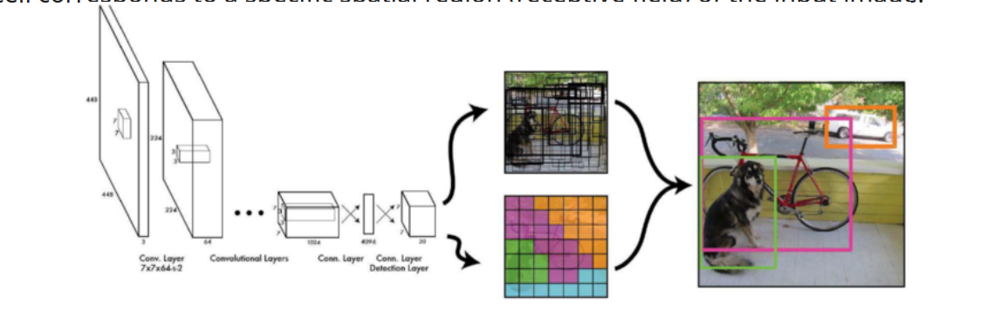


YOLO (You Only Look Once) introduced a single-stage object detection strategy that differs significantly from region-based approaches such as R-CNN, Fast R-CNN, and Faster R-CNN.

Unlike traditional region-based detectors, YOLO performs object localization and classification through a unified prediction framework.

**Which alternative CORRECTLY describes the fundamental principles of YOLO-based object detection?**

**A)** YOLO uses Selective Search to generate candidate regions and independently processes each region through a CNN, similarly to the original R-CNN architecture.

**B)** YOLO first generates candidate regions using a Region Proposal Network (RPN) and then applies ROI Pooling to classify each proposed object, following the same two-stage strategy as Faster R-CNN.

**C)** YOLO divides the original input image into independent image patches and processes each patch through a separate CNN. Bounding boxes are then reconstructed by combining predictions from these independent networks.

**D)** YOLO uses a convolutional backbone to extract spatial feature maps and predicts bounding-box coordinates, objectness scores, and class-related information within a unified detection framework, without requiring a separate region proposal stage.

**E)** YOLO performs object classification directly from the entire image and subsequently applies a segmentation network to recover object boundaries, which are converted into bounding boxes.

<details>
<summary><strong>▶ Show answer</strong></summary>
<div>
<p><strong>Correct Answer: D</strong></p>
<p><strong>Explanation:</strong></p>
<ul>
<li><strong>A — Incorrect:</strong> This describes the original R-CNN approach, which uses Selective Search and independently processes region proposals.</li>
<li><strong>B — Incorrect:</strong> RPN and ROI-based classification are characteristic of Faster R-CNN. YOLO follows a single-stage detection strategy.</li>
<li><strong>C — Incorrect:</strong> YOLO does not independently process raw image patches using separate CNNs. A convolutional backbone extracts spatial feature maps, and predictions are associated with spatial locations in those representations.</li>
<li><strong>D — Correct:</strong> YOLO performs object localization and classification in a unified framework. Its backbone extracts features, while the detection head predicts bounding boxes, objectness-related scores, and class information without a separate proposal stage.</li>
<li><strong>E — Incorrect:</strong> YOLO object detection does not require a segmentation network to recover bounding boxes. Bounding-box coordinates are predicted directly through regression.</li>
</ul>
<p><strong>Key Concept:</strong> YOLO is a single-stage object detector that integrates feature extraction, object localization, and classification into a unified prediction pipeline. Spatial predictions are produced from convolutional feature maps rather than independently processing candidate regions.</p>
</div>
</details>

### Question 37 – YOLO Bounding-Box Predictions and Confidence Scores

In YOLO-based object detection, bounding boxes are predicted through regression, while confidence scores indicate the likelihood that a predicted region contains an object belonging to a particular class.

Consider a simplified YOLO detection model that predicts the following information for a candidate bounding box:

- Bounding-box coordinates: `(x, y, w, h) = (0.25, 0.40, 0.20, 0.10)`
- Objectness probability: `P(object) = 0.80`
- Conditional class probability: `P(car | object) = 0.90`

Assume that the coordinates are normalized relative to the image dimensions and that the class confidence is calculated as:

`Confidence(car) = P(object) × P(car | object)`

**Which alternative CORRECTLY interprets the bounding-box representation and the resulting class confidence?**

**A)** The bounding box is represented by four discrete class labels, and the confidence for the car class is 0.90 because objectness is not considered in class scoring.

**B)** The bounding box coordinates represent continuous regression outputs, and the confidence for the car class is 0.72, obtained by multiplying objectness by the conditional class probability.

**C)** The bounding box coordinates represent pixel-level segmentation masks, and the confidence for the car class is 0.80 because the conditional class probability is used only during training.

**D)** The bounding box coordinates must be converted into integer pixel positions before the network can predict them, and the confidence for the car class is 1.70 because the two probabilities are added.

**E)** The bounding box coordinates represent the number of objects detected in each spatial cell, and the confidence for the car class is 0.10 because the model uses the complement of the conditional class probability.

<details>
<summary><strong>▶ Show answer</strong></summary>
<div>
<p><strong>Correct Answer: B</strong></p>
<p><strong>Explanation:</strong></p>
<ul>
<li><strong>A — Incorrect:</strong> Bounding-box coordinates are continuous regression values rather than discrete class labels. Under the specified scoring formulation, objectness contributes to the class confidence.</li>
<li><strong>B — Correct:</strong> The coordinates (x, y, w, h) represent the predicted bounding-box center and dimensions in normalized image coordinates. The confidence for the car class is 0.80 × 0.90 = 0.72.</li>
<li><strong>C — Incorrect:</strong> Bounding boxes represent rectangular object locations, not pixel-level segmentation masks. The class confidence incorporates both objectness and conditional class probability.</li>
<li><strong>D — Incorrect:</strong> Bounding-box regression predicts continuous coordinates. Probabilities are multiplied under the given formulation, not added.</li>
<li><strong>E — Incorrect:</strong> Bounding-box coordinates describe object location and size, not object counts. The complement of the conditional class probability is not used in the specified confidence calculation.</li>
</ul>
<p><strong>Key Concept:</strong> Object detection combines localization and classification. Bounding-box coordinates are regression outputs, while class confidence can combine objectness and conditional class probabilities. The exact scoring formulation depends on the YOLO version.</p>
</div>
</details>

### Question 38 – YOLO Training, Predictions, and Non-Maximum Suppression

YOLO-based detectors generate multiple candidate bounding boxes, each associated with localization predictions and confidence scores.

During training, predictions must be associated with ground-truth objects, while during inference, overlapping detections may need to be filtered using Non-Maximum Suppression (NMS).

Evaluate the following statements about **YOLO training and inference**.

**I.** YOLO treats bounding-box localization as a regression problem, predicting continuous coordinates that describe object position and dimensions.

**II.** During training, predicted bounding boxes are associated with ground-truth objects according to the model's assignment strategy. Localization and classification losses guide the optimization of the detection network.

**III.** Non-Maximum Suppression is typically applied during inference to remove redundant detections by comparing overlapping bounding boxes and their confidence scores.

**IV.** In conventional greedy NMS, the bounding box with the lowest confidence is selected first, and higher-confidence overlapping boxes are removed to preserve uncertain detections.

**V.** YOLO uses a single-stage detection strategy, but this does not mean that it necessarily produces only one bounding box per image. Multiple candidate boxes can be predicted for different objects.

**Which alternative identifies ALL correct statements?**

**A)** I, II, and III only.

**B)** I, III, and IV only.

**C)** II, III, and V only.

**D)** I, II, IV, and V only.

**E)** I, II, III, and V only.

<details>
<summary><strong>▶ Show answer</strong></summary>
<div>
<p><strong>Correct Answer: E</strong></p>
<p><strong>Explanation:</strong></p>
<ul>
<li><strong>I — Correct:</strong> YOLO predicts bounding-box coordinates as continuous values, making localization a regression task.</li>
<li><strong>II — Correct:</strong> During training, predictions are assigned to ground-truth objects according to the detector's matching strategy. The training objective includes localization and classification components, along with other terms depending on the architecture.</li>
<li><strong>III — Correct:</strong> Conventional NMS removes redundant predictions during inference by comparing confidence scores and spatial overlap, typically measured using Intersection over Union (IoU).</li>
<li><strong>IV — Incorrect:</strong> Conventional greedy NMS prioritizes high-confidence detections. It retains the highest-scoring box and suppresses sufficiently overlapping lower-scoring boxes.</li>
<li><strong>V — Correct:</strong> Single-stage detection refers to the unified prediction strategy, not to the number of objects or bounding boxes detected. YOLO can predict multiple objects within the same image.</li>
</ul>
<p><strong>Key Concept:</strong> YOLO combines bounding-box regression, objectness-related predictions, and class prediction within a single-stage architecture. During training, predictions are matched to ground-truth objects; during inference, confidence filtering and NMS can reduce redundant detections.</p>
</div>
</details>


### Question 39 – Object Detection Pipeline and Architectural Strategies

Object detection systems must identify the presence, category, and spatial location of objects in an image. Although architectures such as R-CNN, Fast R-CNN, Faster R-CNN, and YOLO adopt different computational strategies, they share fundamental detection objectives.

**Which alternative CORRECTLY describes the general object detection pipeline and the differences among these architectures?**

**A)** All object detectors must first divide the input image into independent regions using Selective Search. R-CNN, Fast R-CNN, and Faster R-CNN process these regions using CNNs, while YOLO applies a fully connected network to each region.

**B)** Object detection involves feature extraction, object localization, and classification. R-CNN processes proposed regions independently, Fast R-CNN shares convolutional features across proposals, Faster R-CNN introduces a trainable Region Proposal Network, and YOLO predicts detections without a separate region proposal stage.

**C)** Object detection is fundamentally a pixel-level classification problem. R-CNN and Faster R-CNN predict segmentation masks, Fast R-CNN converts these masks into bounding boxes, and YOLO directly assigns a class label to every pixel.

**D)** R-CNN, Fast R-CNN, Faster R-CNN, and YOLO all generate bounding boxes using the same regression mechanism. Their only architectural difference is the number of convolutional layers used for feature extraction.

**E)** Object detection requires classification before feature extraction. R-CNN and Fast R-CNN first classify the complete image, Faster R-CNN uses an RPN to generate class probabilities without bounding boxes, and YOLO uses NMS to generate its initial candidate regions.

<details>
<summary><strong>▶ Show answer</strong></summary>
<div>
<p><strong>Correct Answer: B</strong></p>
<p><strong>Explanation:</strong></p>
<ul>
<li><strong>A — Incorrect:</strong> Selective Search is used by the original R-CNN and commonly by Fast R-CNN. Faster R-CNN introduces an RPN, while YOLO does not require a separate region proposal stage.</li>
<li><strong>B — Correct:</strong> All four architectures perform feature extraction, localization, and classification, but differ in their computational organization. R-CNN independently extracts features from proposed regions, Fast R-CNN shares convolutional computations, Faster R-CNN integrates an RPN, and YOLO performs detection through a unified single-stage architecture.</li>
<li><strong>C — Incorrect:</strong> Bounding-box object detection is not equivalent to pixel-level segmentation. The described architectures predict object locations and classes rather than requiring pixel-wise masks.</li>
<li><strong>D — Incorrect:</strong> The architectures differ substantially in region proposal generation, feature sharing, and detection stages. Their differences are not restricted to network depth.</li>
<li><strong>E — Incorrect:</strong> Feature extraction precedes the prediction of object categories and locations. An RPN generates candidate regions, while NMS filters redundant predictions rather than generating initial proposals.</li>
</ul>
<p><strong>Key Concept:</strong> The general object detection pipeline combines visual feature extraction, object localization, and classification. The main architectural differences concern how candidate objects are identified, how features are shared, and whether detection uses a single-stage or two-stage strategy.</p>
</div>
</details>

---

### Question 40 – Object Detection: Pipeline, Region Proposals, and Prediction Strategies

Object detection architectures employ different strategies to transform image features into object predictions. Region-based approaches rely on candidate regions, while single-stage approaches integrate localization and classification into a unified prediction framework.

Evaluate the following statements about the **general object detection pipeline and the architectural differences between R-CNN, Fast R-CNN, Faster R-CNN, and YOLO**.

Calculate the sum of the weights associated with the **CORRECT statements**.

**(01)** In object detection, bounding-box coordinates are generally predicted as continuous values, while class predictions identify the object categories associated with the detected regions.

**(02)** R-CNN and Fast R-CNN both use external region proposals, but Fast R-CNN reduces redundant computations by extracting convolutional features from the image before processing individual regions.

**(04)** Faster R-CNN introduces an RPN that generates candidate regions using shared convolutional feature maps, whereas YOLO predicts object detections without a separate region proposal network.

**(08)** R-CNN, Fast R-CNN, Faster R-CNN, and YOLO all require ROI Pooling to convert candidate regions into fixed-size representations before classification.

**(16)** Non-Maximum Suppression can be used to eliminate redundant bounding-box predictions based on confidence scores and spatial overlap, commonly measured using Intersection over Union (IoU).

**(32)** YOLO is classified as a single-stage detector because it predicts only one bounding box per image, whereas R-CNN architectures are two-stage detectors because they always predict exactly two bounding boxes per object.

**Which alternative represents the CORRECT sum?**

**A)** 07

**B)** 19

**C)** 23

**D)** 31

**E)** 55

<details>
<summary><strong>▶ Show answer</strong></summary>
<div>
<p><strong>Correct Answer: C — 23</strong></p>
<p><strong>Explanation:</strong></p>
<ul>
<li><strong>(01) — Correct:</strong> Object localization involves predicting bounding-box coordinates, commonly represented by continuous values such as center coordinates, width, and height. Classification predicts the corresponding object categories.</li>
<li><strong>(02) — Correct:</strong> R-CNN processes proposed regions independently, while Fast R-CNN computes shared convolutional feature maps and extracts region-specific representations using ROI Pooling.</li>
<li><strong>(04) — Correct:</strong> Faster R-CNN replaces external region proposal generation with a trainable RPN. YOLO follows a single-stage strategy without a separate proposal network.</li>
<li><strong>(08) — Incorrect:</strong> ROI Pooling is associated with Fast R-CNN and the original Faster R-CNN detection head. The original R-CNN processes cropped proposals independently, and YOLO does not require ROI Pooling for its standard detection pipeline.</li>
<li><strong>(16) — Correct:</strong> NMS is a post-processing technique that retains high-confidence detections while suppressing sufficiently overlapping lower-confidence predictions.</li>
<li><strong>(32) — Incorrect:</strong> Single-stage and two-stage refer to architectural organization, not the number of bounding boxes predicted. YOLO can detect multiple objects, while region-based detectors can also generate multiple predictions per object.</li>
</ul>
<p><strong>Sum:</strong> 01 + 02 + 04 + 16 = <strong>23</strong>.</p>
<p><strong>Key Concept:</strong> Object detection combines bounding-box regression, classification, and the management of multiple predictions. R-CNN architectures progressively improve feature sharing and proposal generation, while YOLO integrates localization and classification into a single-stage framework. NMS can be applied to both families to reduce redundant detections.</p>
</div>
</details>

### Question 41 – Image Classification, Object Detection, and Image Segmentation

Computer Vision models can perform different prediction tasks depending on the required level of spatial information. Image classification, object detection, semantic segmentation, and instance segmentation differ in their output representations and ability to distinguish individual objects.

**Evaluate the following statements.**

**I.** Image classification predicts image-level categories but does not necessarily provide explicit information about the spatial location of objects.

**II.** Object detection identifies and localizes individual objects, typically using bounding boxes and associated class predictions.

**III.** Semantic segmentation assigns a class label to each pixel, but does not necessarily distinguish different instances belonging to the same class.

**IV.** Instance segmentation combines pixel-level object localization with instance identification, allowing multiple objects of the same class to be distinguished.

**V.** Semantic segmentation and object detection produce equivalent spatial representations because both require predicting rectangular bounding boxes around objects.

**Which alternative identifies ALL correct statements?**

**A)** I, II, and III only.

**B)** I, III, and V only.

**C)** II, III, IV, and V only.

**D)** I, II, III, and IV only.

**E)** I, II, IV, and V only.

<details>
<summary><strong>▶ Show answer</strong></summary>
<div>
<p><strong>Correct Answer: D</strong></p>
<p><strong>Explanation:</strong></p>
<ul>
<li><strong>I — Correct:</strong> Image classification predicts categories associated with the image, without necessarily producing explicit object locations.</li>
<li><strong>II — Correct:</strong> Object detection predicts object categories and their spatial locations, commonly represented by bounding boxes.</li>
<li><strong>III — Correct:</strong> Semantic segmentation assigns semantic categories to pixels but does not distinguish separate instances of the same class.</li>
<li><strong>IV — Correct:</strong> Instance segmentation identifies individual object instances and predicts their corresponding pixel-level masks.</li>
<li><strong>V — Incorrect:</strong> Semantic segmentation produces pixel-level class assignments, whereas object detection typically represents object locations using bounding boxes.</li>
</ul>
<p><strong>Key Concept:</strong> Classification operates at the image level, detection at the object level, semantic segmentation at the pixel-class level, and instance segmentation at the pixel-instance level.</p>
</div>
</details>

---

### Question 42 – Fully Convolutional Networks (FCNs) vs. U-Net

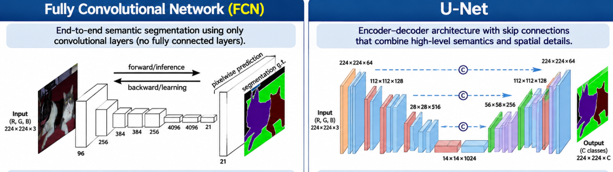

Fully Convolutional Networks (FCNs) introduced an important architectural strategy for dense prediction by replacing traditional fully connected classification layers with convolutional operations.

U-Net builds upon fully convolutional encoder–decoder principles and introduces architectural mechanisms designed to improve spatial reconstruction.

**Which alternative CORRECTLY compares conventional FCN segmentation architectures and U-Net?**

**A)** FCNs require fully connected layers to classify individual pixels, whereas U-Net eliminates convolutional layers and performs segmentation exclusively through transposed convolutions.

**B)** FCNs and U-Net both support dense pixel-level predictions. However, U-Net uses a symmetric encoder–decoder structure with skip connections that transfer high-resolution features from the encoder to corresponding decoder stages, helping recover spatial details.

**C)** FCNs perform object detection by predicting bounding boxes, whereas U-Net performs semantic segmentation by predicting class labels for the entire image.

**D)** FCNs preserve the original image resolution throughout all convolutional layers, while U-Net performs downsampling without any mechanism for recovering spatial information.

**E)** U-Net differs from FCNs primarily because it replaces convolutional feature extraction with recurrent neural networks, allowing the model to process images as sequences of pixels.

<details>
<summary><strong>▶ Show answer</strong></summary>
<div>
<p><strong>Correct Answer: B</strong></p>
<p><strong>Explanation:</strong></p>
<ul>
<li><strong>A — Incorrect:</strong> FCNs eliminate the need for traditional dense classification heads and perform dense predictions using convolutional operations. U-Net also relies extensively on convolutions.</li>
<li><strong>B — Correct:</strong> Both FCNs and U-Net perform dense pixel-level prediction. U-Net employs an encoder–decoder architecture with skip connections between corresponding resolution levels, combining semantic information from deeper layers with spatial details from shallower layers.</li>
<li><strong>C — Incorrect:</strong> FCNs and U-Net can both be used for semantic segmentation. Neither is inherently restricted to bounding-box detection or image-level classification.</li>
<li><strong>D — Incorrect:</strong> Conventional FCNs may reduce spatial resolution and subsequently recover it through upsampling. U-Net also performs downsampling but uses decoder operations and skip connections to reconstruct spatial information.</li>
<li><strong>E — Incorrect:</strong> U-Net is a convolutional architecture, not a recurrent neural network.</li>
</ul>
<p><strong>Key Concept:</strong> U-Net is itself a fully convolutional architecture. Its distinctive contribution is the encoder–decoder design with skip connections that combine high-level semantic representations and high-resolution spatial features. Earlier FCN architectures can also use skip connections, but U-Net employs them systematically across corresponding encoder and decoder stages.</p>
</div>
</details>

---

### Question 43 – U-Net Architecture and Spatial Feature Reconstruction

U-Net is widely used for semantic segmentation, particularly in applications requiring precise localization of structures and object boundaries.

Its architecture consists of a contracting path (encoder), an expanding path (decoder), and skip connections connecting corresponding resolution levels.

Evaluate the following statements about **U-Net architecture**.

Calculate the sum of the weights associated with the **CORRECT statements**.

**(01)** The encoder progressively extracts higher-level semantic features, commonly reducing spatial resolution through pooling or strided convolutions.

**(02)** The decoder progressively reconstructs spatial resolution using upsampling operations and convolutional layers to generate dense predictions.

**(04)** Skip connections transfer feature maps from encoder stages to corresponding decoder stages, allowing the decoder to combine spatial details with higher-level semantic representations.

**(08)** Skip connections eliminate the need for a decoder because the encoder feature maps already contain the final pixel-level segmentation predictions.

**(16)** In the original U-Net architecture, encoder features are concatenated with corresponding decoder features after upsampling, increasing the number of channels available to subsequent convolutional operations.

**(32)** The final segmentation layer must always use Softmax activation, even when the network performs binary segmentation with a single output channel.

**Which alternative represents the CORRECT sum?**

**A)** 07

**B)** 15

**C)** 19

**D)** 23

**E)** 55

<details>
<summary><strong>▶ Show answer</strong></summary>
<div>
<p><strong>Correct Answer: D — 23</strong></p>
<p><strong>Explanation:</strong></p>
<ul>
<li><strong>(01) — Correct:</strong> The encoder extracts increasingly abstract semantic representations while commonly reducing spatial resolution.</li>
<li><strong>(02) — Correct:</strong> The decoder uses upsampling and convolutional operations to progressively recover spatial resolution and produce pixel-level predictions.</li>
<li><strong>(04) — Correct:</strong> Skip connections transfer high-resolution encoder features to decoder stages, improving the reconstruction of fine spatial details.</li>
<li><strong>(08) — Incorrect:</strong> Skip connections complement the decoder rather than replacing it. The decoder is responsible for reconstructing the spatial resolution required for dense predictions.</li>
<li><strong>(16) — Correct:</strong> Original U-Net uses concatenation to combine encoder and decoder feature maps. This increases the channel dimension before subsequent convolutional processing.</li>
<li><strong>(32) — Incorrect:</strong> Binary segmentation with one output channel commonly uses Sigmoid activation. Softmax is typically used for mutually exclusive multiclass segmentation with multiple output channels.</li>
</ul>
<p><strong>Sum:</strong> 01 + 02 + 04 + 16 = <strong>23</strong>.</p>
<p><strong>Key Concept:</strong> U-Net combines a contracting path for semantic feature extraction, an expanding path for spatial reconstruction, and skip connections for preserving fine-grained spatial information.</p>
</div>
</details>

---

### Question 44 – U-Net Implementation and Skip Connections

Consider the following simplified TensorFlow/Keras implementation of a U-Net architecture for **binary semantic segmentation**.

The input images have dimensions `(128, 128, 3)`, and the network must produce a binary segmentation mask with dimensions `(128, 128, 1)`.

```python
import tensorflow as tf
from tensorflow.keras import layers, Model

inputs = layers.Input(shape=(128, 128, 3))

# Encoder
e1 = layers.Conv2D(32, 3, padding="same", activation="relu")(inputs)
p1 = layers.MaxPooling2D(pool_size=(2, 2))(e1)

e2 = layers.Conv2D(64, 3, padding="same", activation="relu")(p1)
p2 = layers.MaxPooling2D(pool_size=(2, 2))(e2)

# Bottleneck
b = layers.Conv2D(128, 3, padding="same", activation="relu")(p2)

# Decoder
u1 = layers.UpSampling2D(size=(2, 2))(b)
c1 = layers.Concatenate()([u1, e2])
d1 = layers.Conv2D(64, 3, padding="same", activation="relu")(c1)

u2 = layers.UpSampling2D(size=(2, 2))(d1)
c2 = layers.Concatenate()([u2, e1])
d2 = layers.Conv2D(32, 3, padding="same", activation="relu")(c2)

outputs = layers.Conv2D(1, 1, activation="sigmoid")(d2)

model = Model(inputs, outputs)
```

**Considering the architecture and the operations performed by each layer, which alternative is CORRECT?**

**A)** The first skip connection concatenates feature maps with incompatible spatial dimensions because `u1` has shape `(128, 128, 128)` and `e2` has shape `(64, 64, 64)`.

**B)** The model produces an output tensor with shape `(32, 32, 1)` because the bottleneck determines the final spatial resolution, independently of decoder operations.

**C)** The encoder reduces spatial resolution from `128 × 128` to `32 × 32`, the decoder restores it to `128 × 128`, and the skip connections concatenate encoder and decoder feature maps at matching spatial resolutions.

**D)** The concatenation operations perform element-wise addition between encoder and decoder feature maps, requiring both tensors to have identical numbers of channels.

**E)** The final layer is incorrectly configured because binary segmentation requires two output channels with Softmax activation instead of one output channel with Sigmoid activation.

<details>
<summary><strong>▶ Show answer</strong></summary>
<div>
<p><strong>Correct Answer: C</strong></p>
<p><strong>Explanation:</strong></p>
<ul>
<li><strong>A — Incorrect:</strong> After the first upsampling operation, u1 has spatial dimensions 64 × 64, matching e2. Concatenation is therefore valid.</li>
<li><strong>B — Incorrect:</strong> The decoder restores spatial resolution through two upsampling operations, producing an output with shape (128, 128, 1).</li>
<li><strong>C — Correct:</strong> The encoder progressively reduces resolution from 128 × 128 to 64 × 64 and then 32 × 32. The decoder reverses this process through upsampling. Skip connections concatenate feature maps at matching spatial resolutions, preserving spatial information.</li>
<li><strong>D — Incorrect:</strong> Concatenation combines feature maps along the channel dimension. Unlike element-wise addition, it does not require equal channel counts.</li>
<li><strong>E — Incorrect:</strong> A single output channel with Sigmoid activation is appropriate for binary segmentation. It produces a probability for the foreground class at each pixel.</li>
</ul>
<p><strong>Tensor Shapes:</strong></p>
<pre>
Input:       (128, 128,   3)
Encoder e1:  (128, 128,  32)
Pooling p1:  ( 64,  64,  32)
Encoder e2:  ( 64,  64,  64)
Pooling p2:  ( 32,  32,  64)
Bottleneck:  ( 32,  32, 128)
Upsample u1: ( 64,  64, 128)
Concat c1:   ( 64,  64, 192)
Decoder d1:  ( 64,  64,  64)
Upsample u2: (128, 128,  64)
Concat c2:   (128, 128,  96)
Decoder d2:  (128, 128,  32)
Output:      (128, 128,   1)
</pre>
<p><strong>Key Concept:</strong> U-Net reconstructs spatial resolution through decoder upsampling operations while using skip connections to integrate high-resolution encoder features. Concatenation requires compatible spatial dimensions but allows different channel counts.</p>
</div>
</details>

### Question 45 – U-Net Implementation: Code Reconstruction

A researcher is implementing a simplified U-Net architecture using TensorFlow/Keras for binary semantic segmentation.

The network receives RGB images of shape `(128, 128, 3)` and must produce pixel-level predictions with shape `(128, 128, 1)`.

However, the following Python statements have been **randomly shuffled**.

**Shuffled Code:**

```python
# A
outputs = layers.Conv2D(1, 1, activation="sigmoid")(d1)

# B
p1 = layers.MaxPooling2D(pool_size=(2, 2))(e1)

# C
model = Model(inputs, outputs)

# D
d1 = layers.Conv2D(32, 3, padding="same", activation="relu")(c1)

# E
inputs = layers.Input(shape=(128, 128, 3))

# F
u1 = layers.UpSampling2D(size=(2, 2))(b)

# G
e1 = layers.Conv2D(32, 3, padding="same", activation="relu")(inputs)

# H
c1 = layers.Concatenate()([u1, e1])

# I
b = layers.Conv2D(64, 3, padding="same", activation="relu")(p1)
```

Assume that the necessary TensorFlow/Keras imports have already been performed.

**Which alternative presents the CORRECT execution order to construct a valid U-Net-like architecture with an encoder, bottleneck, decoder, skip connection, and binary segmentation output?**

**A)** E → G → B → I → F → H → D → A → C

**B)** E → G → I → B → F → H → D → A → C

**C)** E → G → B → I → H → F → D → A → C

**D)** E → G → B → I → F → D → H → A → C

**E)** E → G → B → I → F → H → A → D → C

**F)** E → G → B → I → F → H → D → C → A

<details>
<summary><strong>▶ Show answer</strong></summary>
<div>
<p><strong>Correct Answer: A</strong></p>
<p><strong>Explanation:</strong></p>
<ul>
<li><strong>A — Correct:</strong> The execution order correctly initializes the input, constructs the encoder, performs downsampling, processes the bottleneck, upsamples the features, concatenates the encoder and decoder representations, applies decoder convolution, generates the segmentation output, and constructs the Keras model.</li>
<li><strong>B — Incorrect:</strong> The bottleneck is computed before the pooling operation that defines its input tensor p1.</li>
<li><strong>C — Incorrect:</strong> The concatenation operation is performed before the upsampling tensor u1 has been created.</li>
<li><strong>D — Incorrect:</strong> The decoder convolution uses c1 before the concatenation operation defines it.</li>
<li><strong>E — Incorrect:</strong> The output layer uses d1 before the decoder convolution defines it.</li>
<li><strong>F — Incorrect:</strong> The Keras model is constructed before the output tensor has been defined.</li>
</ul>
<p><strong>Correct Implementation:</strong></p>
<pre>
E  Input
G  Encoder convolution
B  Max pooling
I  Bottleneck
F  Upsampling
H  Skip connection (concatenation)
D  Decoder convolution
A  Binary segmentation output
C  Model construction
</pre>
<p><strong>Tensor Dimensions:</strong></p>
<pre>
Input:        (128, 128,  3)
Encoder:      (128, 128, 32)
Pooling:      ( 64,  64, 32)
Bottleneck:   ( 64,  64, 64)
Upsampling:   (128, 128, 64)
Concatenate:  (128, 128, 96)
Decoder:      (128, 128, 32)
Output:       (128, 128,  1)
</pre>
<p><strong>Key Concept:</strong> A U-Net-like architecture follows an encoder–decoder structure in which spatial resolution is reduced and subsequently restored. Skip connections combine high-resolution encoder features with decoder representations, while a final Sigmoid layer can produce pixel-level foreground probabilities for binary segmentation.</p>
</div>
</details>

### Question 46 – Annotation and Computational Costs in Computer Vision Tasks

Image classification, object detection, and image segmentation require different levels of annotation granularity and computational resources. These differences affect dataset construction, model training, inference, and the scalability of Computer Vision applications.

**Evaluate the following statements regarding annotation effort and computational costs.**

**I.** Image classification generally requires less annotation effort than object detection and segmentation because annotators typically assign image-level labels rather than specifying object locations or pixel-level boundaries.

**II.** Object detection generally requires more detailed annotations than image classification because individual objects must be localized, commonly using bounding boxes. However, bounding-box annotation is typically less labor-intensive than manually producing precise pixel-level segmentation masks.

**III.** Semantic segmentation generally requires more detailed spatial annotations than image classification, since each pixel must be assigned a class. Nevertheless, annotation effort can be reduced through automated labeling tools, weak supervision, or pre-existing masks.

**IV.** Segmentation models always require more computational resources than object detection models because predicting pixel-level masks is inherently more expensive than predicting bounding boxes, regardless of network architecture, input resolution, or hardware.

**V.** Computational cost depends not only on the prediction task but also on model architecture, input resolution, backbone complexity, training strategy, and the number of predicted objects or output classes.

**VI.** Since image classification produces fewer output values than segmentation, classification models are guaranteed to have lower training and inference costs than any detection or segmentation architecture.

**Which alternative identifies ALL correct statements?**

**A)** I, II, and IV only.

**B)** I, II, III, and V only.

**C)** II, III, IV, and V only.

**D)** I, III, V, and VI only.

**E)** I, II, III, IV, and V only.

**F)** I, II, III, V, and VI only.

<details>
<summary><strong>▶ Show answer</strong></summary>
<div>
<p><strong>Correct Answer: B</strong></p>
<p><strong>Explanation:</strong></p>
<ul>
<li><strong>I — Correct:</strong> Image-level annotation generally requires less manual effort than identifying individual object locations or drawing pixel-level masks.</li>
<li><strong>II — Correct:</strong> Bounding-box annotation introduces localization requirements, increasing annotation effort compared with image classification. However, bounding boxes are generally faster to annotate than precise segmentation masks.</li>
<li><strong>III — Correct:</strong> Semantic segmentation requires dense spatial labels, which can be expensive to produce manually. Semi-automated annotation, weak supervision, and other labeling strategies can reduce this burden.</li>
<li><strong>IV — Incorrect:</strong> Computational cost cannot be determined solely by the task. A lightweight segmentation model may require fewer resources than a large object detection model, depending on architecture and experimental conditions.</li>
<li><strong>V — Correct:</strong> Computational complexity depends on multiple factors, including model depth, feature-map dimensions, input resolution, backbone architecture, and training procedures.</li>
<li><strong>VI — Incorrect:</strong> Output dimensionality alone does not determine computational cost. A large classification backbone may require substantially more computation than a lightweight detection or segmentation architecture.</li>
</ul>
<p><strong>Key Concept:</strong> Annotation costs generally increase with spatial annotation granularity: image-level labels, bounding boxes, and pixel-level masks. However, computational costs do not follow a universal ordering across classification, detection, and segmentation. They depend primarily on the specific architecture, data resolution, training configuration, and deployment constraints.</p>
</div>
</details>
